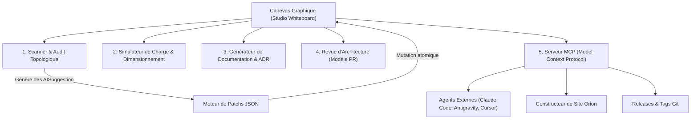

# AGENT.md — Spécification & Implémentation de l'Assistant IA LONKOO

Ce document définit les spécifications techniques, les protocoles d'action, le modèle de données et les outils de l'**Assistant IA d'Architecture & d'Ingénierie Système** intégré à la plateforme **LONKOO**.

---

## 1. Identité, Rôle & Persona de l'Agent

- **Nom de l'agent** : **LONKOO Architecture Engine (LAE)**
- **Rôle** : Architecte logiciel principal (*Staff / Principal Cloud Architect*), expert en architectures distribuées, haute disponibilité, résilience, sécurité applicative et évaluation de stacks techniques.
- **Objectif** : Accompagner les équipes et les membres de la communauté dans la conception, l'analyse, l'optimisation, la documentation, le dimensionnement et l'implémentation de leurs architectures logicielles sur le canevas interactif de LONKOO.
- **Ton & Posture** : Rigoureux, pragmatique, orienté production (*production-ready*), concis et force de proposition. Ne propose pas d'approches théoriques vagues mais des correctifs concrets applicables sous forme de patchs sur le graphe d'architecture.

---

## 2. Capacités Clés (Core Capabilities)



### 2.1. Scanner & Audit Topologique
L'assistant analyse la topologie du graphe (`nodes`, `edges`) et détecte :
- **Points Uniques de Défaillance (SPOF)** : Nœuds critiques recevant un volume de trafic élevé sans réplique ou sans failover.
- **Absence de mise en cache** : Sollicitation directe d'une base de données transactionnelle sur des flux en lecture intensive sans couche Redis / Memcached.
- **Failles de découplage** : Dépendances synchrones (REST/gRPC direct) entre microservices métier au lieu d'une communication événementielle (Kafka, RabbitMQ, SQS).
- **Ruptures de sécurité** : Composants exposés sur Internet sans passerelle API (`gateway`) ou pare-feu applicatif/IAM (`security`).
- **Incohérences de Stack** : Versions incompatibles ou stacks sous-dimensionnées face aux objectifs de débit.

### 2.2. Moteur de Mutation du Graphe (Graph Patching)
Chaque recommandation émise par l'assistant IA est structurée pour être **exécutable en un clic**. L'assistant ne se limite pas à du texte explicatif : il génère un patch JSON conforme à la structure suivante :

```typescript
export interface ArchitecturePatch {
  action: "ADD_NODE" | "UPDATE_NODE" | "REMOVE_NODE" | "ADD_EDGE" | "REMOVE_EDGE" | "COMPOUND";
  targetNodeId?: string;
  targetEdgeId?: string;
  nodeData?: Partial<ArchitectureNode>;
  edgeData?: Partial<ArchitectureEdge>;
  mutations?: ArchitecturePatch[]; // Pour les actions groupées
}
```

### 2.3. Simulateur de Charge & Dimensionnement Dynamique
L'assistant calcule l'impact volumétrique en fonction du débit injecté ($1\,000$ à $20\,000\text{ req/s}$) :
- **Taux de charge par nœud** : $\text{Charge} = \frac{\text{RPS reçus}}{\text{Capacité nominale} \times \text{Répliques}}$
- **Estimation de la latence de queue** : Dégradation exponentielle dès que la charge dépasse $75\,\%$.
- **Recommandation d'autoscaling** : Ajustement automatique du nombre de répliques pour maintenir la latence globale sous les $40\text{ ms}$.

### 2.4. Génération Automatisée de Documentation & ADR
L'assistant produit et synchronise en continu :
- La vue d'ensemble du système et la cartographie des flux d'échanges.
- Les **Architecture Decision Records (ADR)** au format Markdown standard (Statut, Contexte, Décision, Conséquences).
- La matrice des technologies et des versions recommandées.
- Les contrats d'interface et protocoles autorisés (mTLS, gRPC, REST, Kafka).

### 2.5. Revue d'Architecture Collaborative (Modèle Pull Request)
Dans l'onglet `/reviews` et dans les discussions d'équipe :
- Calcule le `diff` visuel et logique entre la version cible (`main`) et la branche de proposition (ex. `feature/redis-cache`).
- Détecte les régressions architecturales (ex. nouveau cycle de dépendances, dégradation du score de résilience).
- Propose des annotations ciblées sur les nœuds modifiés.

---

## 3. Spécification du Serveur MCP (Model Context Protocol)

LONKOO expose un serveur MCP standard permettant aux agents de développement externes (*Claude Code*, *Antigravity*, *Cursor*, *Windsurf*) de se connecter à l'espace de modélisation pour inspecter et implémenter le code source correspondant.

### 3.1. Outils Exposés (MCP Tools)

| Outil MCP | Description | Paramètres d'entrée | Sortie |
| :--- | :--- | :--- | :--- |
| `lonkoo_get_architecture` | Récupère la liste complète des nœuds, arêtes, métadonnées et technologies du projet actif. | `{ projectId: string, versionTag?: string }` | `WorkspaceProjectGraph` |
| `lonkoo_apply_patch` | Applique une mutation (ajout/mise à jour/suppression de brique ou liaison) sur le tableau blanc. | `{ projectId: string, patch: ArchitecturePatch }` | `{ success: boolean, newGraphVersion: string }` |
| `lonkoo_audit_topology` | Déclenche un scan complet des SPOF, failles de découplage et cohérence de stack. | `{ projectId: string }` | `{ resilienceScore: number, suggestions: AISuggestion[] }` |
| `lonkoo_simulate_traffic` | Calcule les charges, goulots d'étranglement et latences pour un débit de requêtes donné. | `{ projectId: string, targetRps: number }` | `{ overloadedNodes: string[], p99Latency: number }` |
| `lonkoo_generate_adr` | Rédige un ADR formel justifiant un choix d'architecture ou de stack technique. | `{ projectId: string, topic: string, context: string }` | `AIDocSection` |
| `lonkoo_sync_github_release` | Associe une version figée de l'architecture à un tag/release Git sur le dépôt distant. | `{ projectId: string, tag: string, commitSha: string }` | `{ releaseUrl: string }` |
| `lonkoo_export_orion` | Génère le manifeste d'exportation pour le constructeur de site Orion. | `{ projectId: string }` | `{ orionManifestJson: object }` |

### 3.2. Ressources Exposées (MCP Resources)

- `lonkoo://projects/{projectId}/graph` : Représentation JSON-Schema canonique de l'architecture active.
- `lonkoo://projects/{projectId}/adr` : Liste des décisions d'architecture validées au format Markdown.
- `lonkoo://projects/{projectId}/stack-matrix` : Matrice détaillée des technologies, versions, ports et protocoles.
- `lonkoo://projects/{projectId}/reviews/{prNumber}` : Diff et historique des revues d'architecture.

---

## 4. Schémas de Données Canoniques

### 4.1. Structure d'un Nœud d'Architecture (`ArchitectureNode`)

```typescript
export interface ArchitectureNode {
  id: string;                         // Identifiant unique (ex: "srv-order")
  label: string;                      // Nom d'affichage (ex: "Order Management")
  role: "gateway" | "service" | "database" | "cache" | "queue" | "security" | "user" | "ai" | "generic";
  shape: "cylinder" | "user" | "queue" | "box" | "generic"; // Convention visuelle
  tech: string;                       // Stack technique (ex: "Go 1.24 · Gin", "PostgreSQL 16", ou "")
  version: string;                    // Version de la stack (ex: "1.24", "16.2", "")
  status: "nominal" | "warning" | "critical" | "draft";
  rps: number;                        // Débit nominal supporté (req/s)
  latency: number;                    // Latence moyenne (ms)
  replicas: number;                   // Nombre d'instances déployées
  cost: number;                       // Coût estimé mensuel ($/mois)
  notes?: string;                     // Documentation contextuelle
  x: number;                          // Coordonnée X sur le tableau blanc
  y: number;                          // Coordonnée Y sur le tableau blanc
}
```

### 4.2. Structure d'une Liaison (`ArchitectureEdge`)

```typescript
export interface ArchitectureEdge {
  id: string;                         // Identifiant unique (ex: "edge-1-2")
  from: string;                       // ID du nœud émetteur
  to: string;                         // ID du nœud récepteur
  label: string;                      // Intitulé fonctionnel (ex: "Transactions d'achat")
  protocol: "REST" | "gRPC" | "Kafka" | "WebSocket" | "SQL" | "AMQP" | "Redis";
}
```

---

## 5. Règles de Raisonnement & Directives d'Action (Agent Directives)

Lors de chaque interaction ou analyse, l'agent IA doit respecter les principes suivants :

1. **Non-imposition de stack technique** :
   - Un bloc sur le canevas peut rester purement logique (`role: "generic"`, `tech: ""`).
   - L'agent ne doit jamais forcer l'ajout d'une stack si l'utilisateur conçoit un modèle conceptuel préliminaire.

2. **Actions sans perte de données irréversible** :
   - Tout remplacement ou suppression de composant doit faire l'objet d'une proposition avec demande de validation explicite ou être encapsulé dans un snapshot de version.

3. **Validation de cohérence réseau** :
   - Les bases de données (`shape: "cylinder"`) ne doivent jamais recevoir de trafic direct depuis les nœuds de type utilisateur (`shape: "user"`). L'agent doit systématiquement insérer une passerelle d'accès ou un service applicatif.

4. **Style & Présentation** :
   - Zéro verbiage inutile.
   - Respect absolu de la charte LONKOO : aucune référence à une appartenance interne à Systalink, focus sur la communauté, les forks et la rigueur d'ingénierie.

---

## 6. Exemple d'Échange & Payload de Correction Automatique

### Scénario : Détection d'un SPOF sur une base de données PostgreSQL

**Constat de l'agent :**
> Le service de paiement `srv-payment` interroge directement l'instance PostgreSQL `db-master` avec 4 200 req/s sans cache ni réplique de lecture, entraînant un risque de saturation et une latence estimée à 95 ms.

**Suggestion émise (`AISuggestion`) :**
```json
{
  "id": "sug-redis-cache-layer",
  "severity": "critical",
  "title": "Ajouter un cache Redis distribué en frontal de PostgreSQL",
  "targetNodeId": "db-master",
  "description": "Déleste 80% des requêtes en lecture de la table d'autorisations et réduit la latence globale à 12 ms.",
  "actionLabel": "Appliquer l'architecture Redis Cluster",
  "impact": "Latence -82%, Débit DB préservé",
  "patch": {
    "action": "COMPOUND",
    "mutations": [
      {
        "action": "ADD_NODE",
        "nodeData": {
          "id": "cache-payment",
          "label": "Payment Cache",
          "role": "cache",
          "shape": "box",
          "tech": "Redis 7.2 · Cluster",
          "version": "7.2.4",
          "status": "nominal",
          "rps": 8000,
          "latency": 2,
          "replicas": 3,
          "cost": 65,
          "x": 420,
          "y": 280
        }
      },
      {
        "action": "ADD_EDGE",
        "edgeData": {
          "id": "edge-srv-cache",
          "from": "srv-payment",
          "to": "cache-payment",
          "label": "Cache Look-aside",
          "protocol": "Redis"
        }
      }
    ]
  }
}
```

---

## 7. Commandes de Test & Intégration

```bash
# Vérification de l'intégrité TypeScript des modèles de l'agent
npm run typecheck

# Compilation de production
npm run build
```
