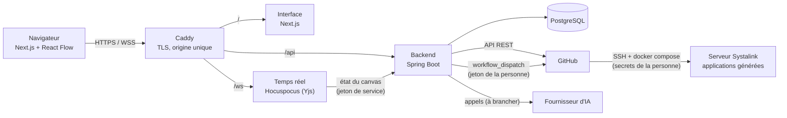

# Passation : ce qui reste avant la démo

> **Document de travail interne** de l'équipe VISION X, rédigé le **25 octobre 2026** par Ibrahima Pouye (backend et temps réel) avec Claude Code. **Destinataires : Serigne Fallou Ngom (IA) et son assistant IA.** Objectif : que le travail continue **sans rupture**, sans avoir à poser de question pour savoir où on en est, quoi faire et comment. Les autres membres y trouvent leur part au § 6. Tenez-le à jour (§ 13). À relire, puis retirer ou archiver avant la soumission (tâche `DOC-3`).
>
> Orthographe : le README et les autres documents écrivent « Serine Fallou Ngom », ce document « Serigne Fallou Ngom ». À harmoniser quand l'orthographe est confirmée (tâche `DOC-5`).

## Sommaire

0. [Mode d'emploi](#0-mode-demploi)
1. [Le projet en deux minutes](#1-le-projet-en-deux-minutes)
2. [Qui fait quoi pour que le travail continue](#2-qui-fait-quoi-pour-que-le-travail-continue)
3. [Mise en route](#3-mise-en-route)
4. [Mission A : l'agent IA](#4-mission-a--lagent-ia)
5. [Mission B : ce qui demande Docker](#5-mission-b--ce-qui-demande-docker)
6. [Tout ce qui reste avant la démo](#6-tout-ce-qui-reste-avant-la-démo)
7. [La démo](#7-la-démo)
8. [Carte du dépôt](#8-carte-du-dépôt)
9. [Décisions déjà prises](#9-décisions-déjà-prises-ne-pas-les-rouvrir)
10. [Pièges connus](#10-pièges-connus)
11. [Définition de « fini »](#11-définition-de--fini-)
12. [Contacts et répartition](#12-contacts-et-répartition)
13. [Journal de passation](#13-journal-de-passation)
- Annexes : [A. Variables d'environnement](#annexe-a--variables-denvironnement) · [B. Essayer les routes de l'IA à la main](#annexe-b--essayer-les-routes-de-lia-à-la-main) · [C. Squelette d'un client IA](#annexe-c--squelette-dun-client-ia)

---

## 0. Mode d'emploi

### 0.1 Pour la personne

Lisez dans l'ordre : le § 1 (2 minutes), le § 2 (votre mission), le § 3 (mise en route, une demi-journée), puis le § 4 (l'agent IA) et le § 5 (Docker). Le reste sert de référence : revenez-y quand vous en avez besoin.

### 0.2 Pour l'assistant IA : à coller au début de chaque session

```text
Tu reprends le travail sur LONKOO (monorepo : backend Spring Boot, serveur temps réel Node, interface Next.js).
Lis EN ENTIER, dans cet ordre :
1. docs/PASSATION-RESTE-A-FAIRE.md (ce que tu dois faire, l'état du projet, les règles)
2. CONTRIBUTING.md (règles d'équipe)
3. docs/AUDIT-ET-ROADMAP-BACKEND.md : le bloc « Situation au 25/10 » et le tableau des constats A-01 à A-16
4. docs/architecture.md et docs/schema-canvas.md (décisions prises et contrat du canvas)
5. Pour la mission IA : tous les fichiers de backend/src/main/java/com/lonkoo/backend/ai/, docs/ROADMAP-BACKEND.md § 9, docs/IA.md
Ensuite, SANS rien modifier : résume-moi en dix lignes l'état du projet, ma mission et les trois premières actions que tu
proposes, puis attends mon accord. Règles : ne pousse jamais sur le dépôt sans mon accord explicite, n'ouvre pas de pull
request sans me le dire, n'affiche jamais le contenu d'un fichier .env ni aucun secret, n'invente ni date, ni chiffre, ni
résultat de test, et dis-moi franchement ce qui n'a pas été essayé en vrai.
```

### 0.3 Les règles non négociables

Elles viennent de `CONTRIBUTING.md` et des décisions du projet. Elles valent pour les humains comme pour les assistants.

1. **Rien directement sur `main`.** Tout passe par une pull request relue par **au moins une autre personne**. Fusion par « merge commit » ou « rebase », **jamais par « squash »** (l'historique prouve que le projet a été fait pendant le concours). Aucun `git push --force` sur `main`, aucune réécriture de l'historique.
2. **Chacun commite avec son propre compte GitHub** (`git config user.name` et `user.email`), par petits commits clairs (`feat:`, `fix:`, `docs:`, `test:`, `ci:` suivis d'une phrase en français).
3. **Aucun secret** dans le code, les journaux, les captures d'écran, les messages de commit ou la conversation avec un assistant. Les vraies valeurs sont dans `.env` (ignoré par Git) ou dans les secrets GitHub. Installer le hook : `pip install pre-commit && pre-commit install` ; **ne jamais le contourner** avec `--no-verify`. Si un secret fuit : le révoquer tout de suite, en créer un autre, prévenir l'équipe.
4. **Licences : seules MIT, Apache 2.0 et BSD.** GPL, AGPL et LGPL rendent le projet irrecevable. Toute nouvelle dépendance se déclare dans `docs/LICENCES-TIERCES.md` **dans la même pull request**, et l'inventaire se régénère (`python3 scripts/make_sbom.py`, sur Windows `python`) : la CI échoue sinon.
5. **Le contrat du canvas** (`docs/schema-canvas.md`, `docs/canvas.schema.json`) ne change que par une pull request relue par l'interface, le backend, l'IA et la génération.
6. **Tout usage d'un outil d'IA** (code, texte, maquettes) est noté dans `docs/IA.md` (date, personne, partie). **Chacun doit pouvoir expliquer le code qu'il pousse** : le jury interroge sur chaque partie.
7. **Ne rien inventer** : ni date du calendrier (elles sont « à confirmer » auprès de l'organisateur), ni chiffre, ni résultat. Une chose qui n'a pas été essayée en vrai se dit telle quelle (voir § 1.4).
8. **Chaque changement a son test**, et tout reste vert avant la pull request (§ 3.7). Bonne habitude : casser volontairement la règle qu'on vient d'écrire et vérifier que le test échoue, puis remettre le code.
9. **Interface** : les règles de `frontend/CLAUDE.md` (§ 5) : surfaces opaques, pas de style « généré par IA », aucune donnée inventée présentée comme réelle, pas d'étiquette décorative.
10. **Pas de marques** (Wave, Orange Money, WhatsApp, logos Systalink) dans le dépôt. LONKOO n'est pas « la plateforme de Systalink ».
11. **Langue** : commentaires, messages d'erreur, documents et messages de commit en français ; noms de classes, de méthodes et de variables en anglais, comme dans le code existant.

---

## 1. Le projet en deux minutes

### 1.1 Ce que fait LONKOO

**Un studio où une équipe de développeurs conçoit ensemble l'architecture de son application, en temps réel, avec un copilote IA, puis la génère, la pousse sur GitHub et la déploie.** Le copilote propose et audite, il ne décide jamais à la place de l'équipe.

Le parcours d'une personne : (1) créer un canvas partagé et inviter son équipe ; (2) dessiner l'architecture à plusieurs (blocs reliés, curseurs en direct) ; (3) demander de l'aide à l'IA (esquisse, complétion, audit) ; (4) enregistrer une version nommée, la comparer, la restaurer ; (5) **générer** le projet de départ (API Spring Boot, interface Next.js, base PostgreSQL, `docker-compose.yml`, documentation, `openapi.yaml`, workflow de déploiement) et le **pousser sur GitHub** ; (6) **déployer** : LONKOO lance le workflow du dépôt de la personne, qui copie le projet sur son serveur et le démarre.

### 1.2 Le concours

- **CADev 2026**, organisé par Systalink. Thème : « Construire la plateforme d'échange africaine, pour les devs, par les devs ». Équipe **VISION X**, 5 membres (§ 12).
- **Échéance de soumission : 20 novembre 2026.** L'**heure exacte** et les **dates du vote des pairs, de la campagne et de la notation du jury sont à confirmer** auprès de l'organisateur (tâche `ORG-1`). Ne pas en inventer.
- **Sans ces conditions, le projet n'est pas noté** (détail : `docs/DECLARATIONS-SOUMISSION.md`) : projet **déployé et accessible en ligne** ; au moins **un produit Datacloud acheté** avec le code promo de l'équipe (VPS à Dakar de préférence) ; **aucune** licence GPL, AGPL ou LGPL ; projet réalisé pour l'essentiel pendant le concours (à partir du 29 septembre) ; équipe inscrite sur la plateforme Datacloud, membres majeurs.
- **Les 5 membres doivent voter** au vote des pairs, sous peine d'exclusion de l'équipe.

### 1.3 Comment c'est construit



| Morceau | Technologie | Rôle |
|---|---|---|
| `frontend/` | Next.js 16, React 19, TypeScript, Tailwind 4 | écrans, tableau blanc, exports |
| `backend/` | Spring Boot **4.1.1**, Java 21, PostgreSQL 16, Flyway, `JdbcClient` (pas de JPA), Log4j2, Jackson **3** | comptes, droits, projets, versions, génération, GitHub, déploiement, **routes de l'IA** |
| `realtime/` | Node, Hocuspocus 4 + Yjs | édition collaborative, présence, curseurs, lecture seule, coupure des accès retirés |
| `infra/` | Caddy, Docker Compose | pile de production, sauvegarde et restauration |
| `e2e/`, `scripts/`, `docs/` | Playwright, scripts Python | parcours dans un vrai navigateur, SBOM, licences, documents |

Le canvas existe sous deux formes : l'**état courant** (document Yjs, binaire, modifié en direct) et l'**instantané** (JSON validé par `docs/canvas.schema.json`, utilisé par les versions, l'export, l'IA et le générateur). L'IA lit et produit des **instantanés**.

### 1.4 Où on en est au 25 octobre 2026

La pull request n° 2 (`backend` vers `main`, https://github.com/Pouye15/Lonkoo/pull/2) contient tout le code ; **sa CI est verte (12 jobs sur 12) au 25/10**. Elle attend une relecture et une fusion (tâche `PR-1`).

| Domaine | État | Essayé en vrai ? |
|---|---|---|
| Studio collaboratif temps réel, versions, comparaison, exports Mermaid, JSON, SVG, PNG | fait, testé | oui (parcours `e2e/` dans un navigateur) |
| Comptes (invité, GitHub), projets, équipe et rôles, liens de partage révocables, projets publics en lecture seule, galerie | fait, testé | oui |
| Sessions en base (un redémarrage ne déconnecte plus personne) ; jeton GitHub gardé **en mémoire du serveur** (perdu au redémarrage, voulu) | fait, testé | oui |
| Génération du projet, envoi sur GitHub, lancement et suivi du déploiement | fait, testé contre un **faux GitHub** | **une fois contre le vrai GitHub le 25/10** : connexion, dépôt privé, 32 fichiers envoyés, workflow lancé et suivi ; **le workflow a échoué comme prévu** (ni serveur ni secrets) |
| **Projet généré construit avec Docker** (`docker compose up --build`) | écrit, jamais construit | **non** : Ibrahima n'a pas Docker. C'est la mission B |
| **IA : point de raccordement** (`AiClient`, 3 routes validées, quota par jour, agent factice `fake`) | fait, testé | oui, sans fournisseur |
| **IA : agent réel** | **à faire** : aucun fournisseur choisi | non. C'est la mission A |
| Onglet « Analyse IA » de l'interface | **données de démonstration locales** (aucun appel à l'API) | non |
| Communauté (profils, revues, commentaires, Fork), Revues, MCP, Orion | maquettes (seule la galerie publique est réelle) | non |
| Mise en ligne de LONKOO (compose de production, Caddy, pipeline, sauvegarde et restauration) | écrite ; la CI démarre la pile de production, sauvegarde et restaure | **jamais sur un serveur** : il n'y en a pas encore |
| Qualité | 370 tests Java (1 ignoré), 50 temps réel, 71 interface, 71 vérifications navigateur ; CI 12 jobs ; SBOM CycloneDX ; contrôle des licences ; gitleaks | CI verte |

Le détail des constats (A-01 à A-16) et des preuves est dans `docs/AUDIT-ET-ROADMAP-BACKEND.md`.

---

## 2. Qui fait quoi pour que le travail continue

### 2.1 Ce qu'Ibrahima doit faire avant que la reprise soit possible

- [ ] **Pousser** les derniers commits sur la branche `backend` du dépôt `Pouye15/Lonkoo` (la pull request n° 2 se met à jour toute seule). Attention : sur son poste, le remote `origin` pointe vers un **autre** dépôt (`Gnatam/Lonkoo-frontend`) ; le bon remote s'appelle `upstream`.
- [ ] **Inviter Serigne Fallou comme collaborateur** (rôle *Write*) : dépôt `Pouye15/Lonkoo`, Settings, Collaborators. **Au 25/10, il n'y est pas** : les collaborateurs sont Pouye15 (administrateur), mouhaa-md, mifall-cloud et Gnatam (*Write*). Sans cette invitation, il ne peut ni cloner le dépôt privé ni pousser.
- [ ] **Faire relire la pull request n° 2** par un autre membre (règle d'équipe), pour la fusionner. Les points à relire en priorité sont listés dans la section « À relire en priorité » de sa description.
- [ ] **Transmettre hors dépôt** (messagerie de l'équipe) : `Guide-actions-humaines-mise-en-ligne.pdf`, `Guide-defense-jury.pdf`, `Cahier_de_charges CADEV lonkoo.pdf`. Ils sont sur son poste, pas dans le dépôt.
- [ ] **Créer l'application OAuth GitHub de production** quand le domaine existe (`PROD-3`) : elle se crée sur le compte propriétaire du dépôt. Transmettre l'identifiant et le secret **par un canal sûr** à la personne qui configure le serveur, jamais dans le dépôt.
- [ ] **Rester joignable** pour les questions sur les droits d'accès, les sessions, le serveur temps réel, la génération côté serveur, et relire les pull requests qui touchent `backend/` et `realtime/`.

Tout le reste (code, tests, documents utiles, scripts de vérification) est **dans le dépôt** après ce push. Ce qui reste uniquement sur le poste d'Ibrahima : son fichier `.env` (secrets, à ne pas partager), son application OAuth de développement, ses PostgreSQL et Node locaux, et les trois PDF ci-dessus.

### 2.2 La mission de Serigne Fallou, en bref

| Mission | Contenu | Où |
|---|---|---|
| **A. L'agent IA** | choisir le fournisseur, écrire le client derrière `AiClient`, les consignes (prompts), les tests, brancher l'onglet « Analyse IA » avec Fall, déclarer l'usage dans `IA.md`, préparer une démo de secours | § 4 |
| **B. Ce qui demande Docker** | construire et lancer **le projet généré** avec `docker compose` (jamais fait), puis en faire un contrôle automatique de la CI ; rejouer la pile de production si besoin | § 5 |
| **C. Le reste de l'équipe** | tenir ce document à jour, relire des pull requests, répéter la démo | § 6, § 7 |

### 2.3 Ordre conseillé pour les premiers jours

1. **Jour 1** : accès au dépôt et mise en route (§ 3), lecture du § 4. Lancer l'application avec `AI_PROVIDER=fake` et appeler les trois routes de l'IA à la main (annexe B) pour voir ce que le reste du backend fait déjà.
2. **Jours 1 et 2** : `DK-1` (le projet généré sous Docker, si Docker est disponible : il peut révéler un défaut du générateur qui bloquerait la démo) et `IA-1` (choix du fournisseur : il débloque tout le reste et fixe le coût).
3. **Jours 2 à 4** : `IA-2` à `IA-6` (configuration, client, consignes, tests, essai réel).
4. **Jours 4 à 6** : `IA-7` avec Fall (l'interface), puis `IA-8` et `IA-9` (déclarations, démo de secours).
5. **En continu** : le journal (§ 13), les pull requests petites et relues.

Les durées sont indicatives (travail avec un assistant) ; c'est l'ordre qui compte.

---

## 3. Mise en route

### 3.1 Accès

- [ ] Un compte GitHub personnel, invité comme collaborateur *Write* de `Pouye15/Lonkoo` (§ 2.1), invitation acceptée.
- [ ] `git config user.name` et `git config user.email` liés à ce compte.
- [ ] Les trois documents de l'équipe hors dépôt (§ 2.1) si besoin.

### 3.2 Outils

| Outil | Version | Pour quoi |
|---|---|---|
| Git | récent | tout |
| JDK | 21 ou plus (le projet compile en `release 21`) | backend |
| Node.js | 22 ou plus (24 recommandé, comme le `.devcontainer`) | interface, temps réel, e2e |
| Python | 3 | `pre-commit`, scripts (`scripts/`) |
| PostgreSQL 16 | via Docker **ou** installé en local, mêmes nom, utilisateur et mot de passe que dans `.env` | base de développement |
| Docker | **facultatif** pour le développement courant, **nécessaire** pour le § 5 | PostgreSQL de développement, images, projet généré |

`./mvnw test` n'a **pas** besoin de Docker : les tests du backend démarrent leur propre PostgreSQL embarqué.

**Pas de Docker sur votre machine ?** Le dépôt contient un `.devcontainer` (Java 21, Node 24, Python 3.12 et **docker-in-docker**, ports 3000, 8080 et 1234 transférés) : il s'ouvre dans **GitHub Codespaces** (quota gratuit mensuel limité, à vérifier sur votre compte) ou dans VS Code avec l'extension Dev Containers. C'est aussi une solution pour qui ne peut pas installer Docker (virtualisation inactive, par exemple).

### 3.3 Cloner et créer sa branche

```bash
git clone https://github.com/Pouye15/Lonkoo.git
cd Lonkoo
git checkout backend            # tant que la pull request n° 2 n'est pas fusionnée ; ensuite : main
git pull
git checkout -b feature/ia-agent    # une branche = une tâche (feature/..., fix/..., docs/...)
pip install pre-commit && pre-commit install
```

N'utilisez pas l'ancien dépôt `Gnatam/Lonkoo-frontend` : le dépôt de référence est `Pouye15/Lonkoo`.

### 3.4 Configuration

```bash
cp .env.example .env
```

Les valeurs d'exemple suffisent pour tout, **sauf** se connecter avec GitHub et appeler un vrai fournisseur d'IA. Réglages utiles en développement (dans `.env`, jamais commité) :

| Réglage | Pourquoi |
|---|---|
| `GUEST_RATE_LIMIT_PER_HOUR=1000` | par défaut 20 invités par heure et par adresse : on les épuise vite en essayant |
| `AI_PROVIDER=fake` | réponses figées étiquetées `demo`, sans clé (par défaut `.env.example` met `change-me`, donc les routes répondent 501) |
| `AI_GUEST_DAILY_QUOTA=100` | un invité n'a que 5 appels d'IA par jour : trop peu pour développer |
| `NEXT_PUBLIC_API_MODE=live` dans `frontend/.env.local` | sans ce fichier, l'interface est en mode démonstration et n'appelle pas le backend |

**Connexion GitHub en développement** : chacun crée **sa propre** application OAuth (5 minutes, pas à pas dans `docs/GITHUB-OAUTH.md`) avec l'adresse de retour `http://localhost:3000/api/auth/github/callback`, puis met `GITHUB_OAUTH_CLIENT_ID` et `GITHUB_OAUTH_CLIENT_SECRET` dans **son** `.env`. Ne demandez pas ceux d'un autre.

### 3.5 Lancer les quatre services

Un terminal par service, à la racine du dépôt. PostgreSQL (5432), backend (8080), temps réel (1234), interface (3000).

```bash
# 1. Base de données (si Docker) ; sinon PostgreSQL local avec les valeurs de .env
docker compose -f infra/docker-compose.dev.yml --env-file .env up -d

# 2. Backend (le profil dev lit le .env de la racine)
cd backend
./mvnw spring-boot:run "-Dspring-boot.run.profiles=dev"        # PowerShell : .\mvnw.cmd spring-boot:run "-Dspring-boot.run.profiles=dev"

# 3. Temps réel (npm run dev lit le .env de la racine ; npm start n'en lit aucun)
cd realtime && npm ci && npm run dev

# 4. Interface (créer d'abord frontend/.env.local)
cd frontend
printf 'NEXT_PUBLIC_API_MODE=live\nNEXT_PUBLIC_REALTIME_URL=ws://localhost:1234\n' > .env.local
npm ci && npm run dev
```

Sur un poste **Windows**, le backend peut ne pas joindre GitHub en HTTPS (réponse 503 « GitHub est injoignable ») : ajouter `"-Dspring-boot.run.jvmArguments=-Djavax.net.ssl.trustStoreType=Windows-ROOT"`. **Le même réglage sera nécessaire pour joindre le fournisseur d'IA** si l'appel échoue sur une erreur de certificat (PKIX).

### 3.6 Vérifier que tout marche

```bash
curl http://localhost:8080/api/actuator/health   # {"status":"UP"}
curl http://localhost:1234/health                # {"status":"UP"}
```

Ouvrez <http://localhost:3000>, « Essayer sans compte » : le modèle d'exemple s'ouvre. Si l'interface propose des projets simulés sans erreur, `frontend/.env.local` manque. Le tableau « Si ça ne démarre pas » du `README.md` couvre les autres symptômes.

### 3.7 Les tests et contrôles

| Quoi | Commande | Attendu au 25/10 |
|---|---|---|
| Backend (PostgreSQL embarqué, sans Docker) | `cd backend && ./mvnw test` | 370 tests, 1 ignoré, 0 échec (environ 3 minutes) |
| Seulement l'IA | `cd backend && ./mvnw test -Dtest='Ai*'` | moins d'une minute |
| Temps réel | `cd realtime && npm test` | 50 tests |
| Interface | `cd frontend && npm test && npm run lint && npm run typecheck` | 71 tests, lint et types sans erreur |
| Parcours dans un navigateur | `cd e2e && npm ci && npm run install-browser && npm run e2e` (contre l'application qui tourne) | 71 vérifications |
| Inventaire des composants (SBOM) | `python3 scripts/make_sbom.py --verify` | échoue si `docs/sbom/` ne correspond plus aux dépendances |
| Contrat OpenAPI | `python3 -m pip install openapi-spec-validator && python3 -m openapi_spec_validator docs/openapi.yaml` | `OK` |
| Secrets | `pre-commit run gitleaks --all-files` (ou le job CI) | aucun secret |

**Ne lancez pas `./mvnw clean test` pendant que le backend tourne via `spring-boot:run`** : il vit dans `backend/target/classes`. Arrêtez-le d'abord.

### 3.8 Travailler au quotidien

- Une branche par tâche, nom court : `feature/ia-agent`, `fix/...`, `docs/...`. Fusionner au moins une fois par jour : les branches longues créent des conflits.
- Pull requests de moins de 300 lignes quand c'est possible, relecture sous 4 heures par quelqu'un d'autre.
- `docs/IA.md` et `docs/LICENCES-TIERCES.md` se mettent à jour **dans la même pull request** que le changement.
- Les migrations Flyway ont des plages par personne : `V1` à `V9` (socle), `V10` à `V19` (génération et déploiement : V10 et V11 ; liens de partage et sessions : V12 et V13), **`V20` à `V29` (IA)**. **`V20` est déjà prise** (`ai_usage`, le quota) ; la prochaine libre est **`V21`**. Une migration déjà appliquée ne se modifie jamais : on en ajoute une autre.

---

## 4. Mission A : l'agent IA

### 4.1 Ce qui existe déjà

Tout est dans `backend/src/main/java/com/lonkoo/backend/ai/`. **Le reste du backend ne sait rien du fournisseur** : on écrit une classe derrière une interface, et rien d'autre ne change.

| Fichier | Rôle |
|---|---|
| `AiClient.java` | **l'interface à implémenter** : `sketch`, `complete`, `audit`, `demo()` |
| `FakeAiClient.java` | agent de démonstration (`AI_PROVIDER=fake`) : réponses figées valides ; **c'est l'exemple à suivre** |
| `AiService.java` | tout ce que le serveur fait **avant et après** l'appel (voir 4.2) |
| `AiController.java` | les trois routes |
| `AiQuota.java` | quota d'appels par jour (migration `V20__usage_ia.sql`, table `ai_usage`) |
| `AiProposal`, `AiFinding`, `AiProposalResponse`, `AiAuditResponse`, `AiCompleteRequest`, `AiSketchRequest` | les formes échangées |
| `AiNotImplementedException` (501), `AiOutputInvalidException` (502), `AiUnavailableException` (502, 503 ou 504) | les erreurs, en `application/problem+json` |

Tests à lire comme modèles : `AiFakeAgentIntegrationTest`, `AiOutputGuardIntegrationTest`, `AiQuotaIntegrationTest`, `AiNotConfiguredIntegrationTest` (dans `backend/src/test/java/com/lonkoo/backend/`). Le contrat HTTP est dans `docs/openapi.yaml` (`/canvases/{canvasId}/ai/*`), la décision d'architecture dans `docs/architecture.md`, le chapitre dans `docs/ROADMAP-BACKEND.md` § 9.

**Attention : `frontend/AGENT.md` décrit une vision beaucoup plus large** (patchs JSON applicables en un clic, simulateur de charge, serveur MCP, revues d'architecture) que ce qui est implémenté. **Ce n'est pas le contrat actuel.** Le contrat actuel est celui du tableau ci-dessous ; le serveur MCP et les patchs sont explicitement hors périmètre (`ROADMAP-BACKEND.md` § 9). Utilisez `AGENT.md` pour le ton et les règles de raisonnement (4.5), pas pour la forme des réponses.

### 4.2 Le contrat avec le reste du backend

| Route | Droit requis | Entrée (JSON) | Sortie | Contrôle du serveur sur la sortie |
|---|---|---|---|---|
| `POST /api/canvases/{id}/ai/sketch` | écrire (`WRITE` et plus) | `{"brief": "texte"}` (8000 caractères au plus) | `{canvas, summary, demo}` | l'instantané doit respecter le contrat du canvas, sinon **502** |
| `POST /api/canvases/{id}/ai/complete` | écrire | `{"nodeIds": ["…"], "instruction": "…"}`, tout facultatif (50 blocs au plus) | `{canvas, summary, demo}` | idem ; un bloc désigné qui n'existe pas donne **400** |
| `POST /api/canvases/{id}/ai/audit` | **membre** du projet (pas un simple visiteur d'un projet public : un appel coûte de l'argent) | aucune | `{findings, discarded, demo}` | les remarques qui visent un bloc absent du canvas sont **écartées et comptées** (`discarded`) |

Une remarque d'audit (`AiFinding`) : `id`, `severity` (`CRITICAL`, `RECOMMENDED`, `OPTIMIZATION`), `category` (`RESILIENCE`, `STACK`, `SECURITY`, `PERFORMANCE`), `title`, `targetNodeId`, `rationale`, `currentConfig`, `proposedConfig`. Elle est **consultative** : elle ne modifie jamais le canvas.

**Ce que `AiService` fait pour vous, dans cet ordre** : contrôle du droit (404 pour un étranger, 403 pour un rôle insuffisant) ; 501 si aucun fournisseur n'est branché ; plafond de taille du texte (`AI_MAX_INPUT_CHARS`, 8000) ; lecture de l'instantané courant auprès du serveur temps réel (`complete`, `audit`) ; existence des blocs désignés ; **quota** (30 appels par jour et par compte GitHub, 5 par invité, 500 pour tout le service, **429** avec `Retry-After` au-delà ; compté **juste avant** l'appel au fournisseur, que celui-ci réponde ou non) ; **votre appel** ; validation de la sortie contre le contrat ; une ligne `ai.sketch`, `ai.complete` ou `ai.audit` dans le journal d'audit, **jamais le texte saisi ni la réponse**. Rien n'est écrit dans le canvas : une proposition se renvoie à la personne, qui l'accepte ou non.

**Ce que votre implémentation doit faire** : respecter le délai maximal (`AI_TIMEOUT_SECONDS`) ; lire sa clé dans la configuration du serveur (**jamais** envoyée au navigateur, jamais dans une variable `NEXT_PUBLIC_*`) ; ne rien journaliser du contenu (ni la saisie, ni la réponse, ni la clé) ; signaler une panne du fournisseur par `AiUnavailableException` (message en français, **sans clé ni détail interne** : il s'affiche tel quel) ; renvoyer `demo() == false` (la valeur par défaut) pour un vrai fournisseur.

### 4.3 Les étapes

| ID | Quoi | Où | Fini quand |
|---|---|---|---|
| `IA-1` | **Choisir le fournisseur et le modèle** (critères en 4.4) et **noter la décision** | `docs/architecture.md` : déplacer la ligne « Fournisseur et modèle d'IA » de « Décisions ouvertes » vers « Décisions prises », avec la date ; `docs/IA.md` § 2 | la décision est écrite : fournisseur, modèle, conditions d'utilisation lues, données envoyées, coût estimé par appel, budget jusqu'à la notation |
| `IA-2` | **Configuration** : lire `AI_API_KEY`, `AI_MODEL`, `AI_TIMEOUT_SECONDS` (aujourd'hui **aucune de ces trois variables n'est lue par le backend**). Ajouter dans `application.properties` : `lonkoo.ai.api-key=${AI_API_KEY:}`, `lonkoo.ai.model=${AI_MODEL:}`, `lonkoo.ai.timeout-seconds=${AI_TIMEOUT_SECONDS:30}` et `lonkoo.ai.base-url` (pour viser un faux serveur dans les tests). Les passer au backend en production : `infra/docker-compose.prod.yml` (liste des réglages facultatifs, qui contient déjà `AI_PROVIDER` et les quotas) et `infra/production.env.example`. **Étendre `ConfigurationCheck`** (`backend/.../support/`) : en profil `prod`, refuser une clé ou un modèle `change-me` quand `AI_PROVIDER` n'est ni `off` ni `fake` | `backend/src/main/resources/application.properties`, `infra/`, `ConfigurationCheck.java` | un démarrage en profil `prod` avec une clé d'exemple est refusé (test dans `ConfigurationCheckTest`) |
| `IA-3` | **Le client** : une classe `XxxAiClient implements AiClient`, `@Component` + `@ConditionalOnProperty(prefix = "lonkoo.ai", name = "provider", havingValue = "xxx")`, comme `FakeAiClient`. Appels HTTP avec le `java.net.http.HttpClient` du JDK (comme `GithubRepoClient` et `RealtimeSnapshotClient`) : **aucune dépendance nouvelle**, donc aucun contrôle de licence ni SBOM à refaire. Délai de connexion et délai par requête. Squelette en annexe C | `backend/src/main/java/com/lonkoo/backend/ai/` | `AI_PROVIDER=xxx` + une vraie clé : les trois routes répondent avec une vraie proposition |
| `IA-4` | **Les consignes (prompts) et la sortie contrainte** (4.5) : une pour l'esquisse, une pour la complétion, une pour l'audit ; sortie en JSON conforme au contrat si le fournisseur sait contraindre une sortie par un schéma ; **au plus une reprise** en renvoyant au modèle les erreurs du validateur (`CanvasValidator`, déjà un bean Spring) | idem | une sortie invalide est reprise une fois, puis refusée (502) ; jamais corrigée en silence |
| `IA-5` | **Tests sans réseau** : un faux fournisseur (un `HttpServer` du JDK, comme `FakeGithubApiServer` du dossier de tests) et `@TestPropertySource(properties = "lonkoo.ai.provider=xxx")`. Cas : proposition valide ; texte non JSON ; JSON qui viole le contrat (502 avec `errors`) ; fournisseur en 500, en 429, trop lent (504) ; la clé n'apparaît jamais dans une réponse ni un journal ; le quota est compté **une** fois même avec une reprise ; remarque sur un bloc absent écartée | `backend/src/test/java/com/lonkoo/backend/` | `./mvnw test` vert ; casser une règle fait échouer le test |
| `IA-6` | **Essai réel** avec une vraie clé (annexe B) : latence, coût par appel, qualité. **Régler `AI_GLOBAL_DAILY_CAP`** : coût maximal par jour = plafond × coût moyen d'un appel | votre poste | chiffres notés dans `docs/IA.md` ; plafond choisi |
| `IA-7` | **Brancher l'interface** avec Fall (4.6) | `frontend/` | l'onglet « Analyse IA » appelle l'API réelle ; plus aucune donnée inventée |
| `IA-8` | **Déclarations** : `docs/IA.md` § 1 (vos usages d'outils d'IA, en votre nom) et § 2 (fournisseur, modèle, conditions, données envoyées, coût) ; cocher les « points à vérifier avant la soumission » ; `docs/LICENCES-TIERCES.md` et `python3 scripts/make_sbom.py` **seulement** si vous ajoutez une dépendance | `docs/` | les quatre cases de `IA.md` § 2 sont cochées |
| `IA-9` | **Démo de secours** : des captures ou une courte vidéo d'une esquisse et d'un audit réussis, au cas où le fournisseur serait indisponible le jour de la démo. Solution de repli en direct : `AI_PROVIDER=fake` dans le `.env` du serveur puis redémarrer le backend ; les réponses disent alors « démonstration » (les sessions sont en base : personne n'est déconnecté) | `docs/`, vidéo hors dépôt | la démo de secours existe et l'équipe sait la lancer |

### 4.4 Choisir le fournisseur

Critères posés dans `docs/architecture.md` (« Décisions ouvertes ») : **sortie JSON contrainte** par `docs/canvas.schema.json` ; **clé côté serveur** ; **quota par utilisateur et plafond de coût** (le quota est fait) ; **délai maximal** ; **conditions d'utilisation vérifiées** ; **démo enregistrée** si l'IA est indisponible ; **un seul fournisseur**, derrière `AiClient`.

À vérifier en plus : le fournisseur accepte-t-il cet usage (conditions d'utilisation) ; **garde-t-il ou réutilise-t-il les données envoyées** (les canvas des utilisateurs, le texte du cahier des charges) ; son service est-il joignable depuis le serveur de Dakar avec une latence acceptable ; son prix par appel avec un instantané de plusieurs centaines de lignes de JSON ; son plafond de débit (il se partage entre tous les jurés) ; un compte gratuit ou un crédit suffit-il pour la période de notation. **Aucune donnée personnelle réelle** ne doit lui être envoyée (`docs/IA.md` § 2). Le choix appartient à Serigne Fallou, avec l'accord de l'équipe pour le budget.

### 4.5 Ce que l'agent doit respecter

- **Le contrat du canvas** (`docs/schema-canvas.md`, `docs/canvas.schema.json`, exemple complet : `docs/exemples/marketplace-mobile.canvas.json`) : `schemaVersion` à `1`, 9 types de blocs (`webapp`, `service`, `database`, `auth`, `queue`, `mobile-payment`, `messaging`, `billing`, `generic`), liens `http`, `event`, `data` ou `auth`. Identifiants techniques `name` : `^[a-z][a-z0-9_]{0,30}$`, **uniques**, **pas de mot réservé** Java, SQL ou YAML (`backend/.../canvas/ReservedWords.java`). Limites : 200 blocs, 500 liens, 40 entités par base, 40 champs par entité. Un lien désigne des blocs qui existent. **Seuls les `name` finissent dans le code généré** : les libellés ne servent qu'à l'affichage.
- **Pas de marque** dans les blocs locaux : `mobile-payment` et `messaging` sont génériques (pas de Wave, d'Orange Money, de WhatsApp).
- Règles de `frontend/AGENT.md` § 5 : **ne jamais imposer une stack** (un bloc peut rester logique, `tech` vide) ; **aucune perte irréversible** (tout remplacement ou suppression est une proposition à valider) ; **cohérence réseau** (une base de données ne reçoit pas de trafic direct d'un utilisateur : insérer une passerelle ou un service) ; ton rigoureux, concis, sans verbiage ; aucune référence à une appartenance de LONKOO à Systalink.
- **`complete`** : conserver les identifiants (`name`) des blocs existants ; n'ajouter ou ne modifier que ce qui est demandé. `AiService` ne vérifie **pas** que la complétion conserve les blocs d'origine : une garde utile à ajouter (comparer les identifiants avant et après, refuser ou signaler une suppression silencieuse).
- **`audit`** : quelques remarques utiles (5 à 10), chacune sur un bloc **qui existe**, avec une proposition concrète.
- **Sécurité** : le texte saisi et les libellés du canvas sont des **données non fiables** (injection de consignes possible). Le modèle n'agit sur rien ; sa sortie est validée comme une donnée. Ne donnez jamais au modèle un moyen d'exécuter quoi que ce soit.

### 4.6 Brancher l'interface (`IA-7`, avec Fall)

Aujourd'hui l'onglet « Analyse IA » de `frontend/src/app/(app)/studio/page.tsx` affiche une liste figée (`AI_SUGGESTIONS` dans `frontend/src/lib/lonkoo-data.ts`) et un **score de cohérence inventé** (`86 + 5 × correctifs appliqués`). Il n'appelle pas l'API. Le front interdit les données inventées présentées comme réelles (`frontend/CLAUDE.md` § 5, règle 4).

Proposition (à valider avec Fall, propriétaire de l'interface) :

1. **Éviter de gonfler `studio/page.tsx`** (1177 lignes, source de conflits avec Fall) : créer `frontend/src/lib/ai-api.ts` (appels, sur le modèle de `members-api.ts` et `generation-api.ts`, avec `apiFetch` de `lib/api.ts`), `frontend/src/lib/ai.ts` (formes et règles pures, avec ses tests dans `lib/ai.test.ts`) et un composant `frontend/src/components/studio/live/AiPanel.tsx`. Dans `page.tsx`, ne remplacer que le corps de l'onglet par ce composant.
2. **Correspondance des remarques** : `severity` `CRITICAL`, `RECOMMENDED`, `OPTIMIZATION` vers « critique », « recommandé », « optimisation » ; `category` `RESILIENCE`, `STACK`, `SECURITY`, `PERFORMANCE` vers « Résilience », « Stack Technique », « Sécurité », « Performance ». L'API ne renvoie ni `impactScore` ni `patch` : **supprimer le score inventé**, ou le calculer d'après les remarques réelles.
3. **Un bouton « Lancer l'analyse »** (`POST …/ai/audit`) ; états : en cours, résultat, vide ; erreurs lisibles : **429** (quota : dire que c'est la limite du jour), **501** (« l'agent n'est pas branché »), **502/503/504** (fournisseur indisponible). `messageOf(error)` de `lib/api.ts` lit déjà le `detail` des erreurs `problem+json`.
4. **Afficher « réponse de démonstration »** quand `demo` vaut `true` (jamais présenter une réponse figée comme celle d'un agent).
5. **Corriger** : une remarque est consultative. « Demander une correction » peut appeler `POST …/ai/complete` avec `nodeIds: [targetNodeId]` et `instruction: proposedConfig`. La proposition reçue est un **instantané complet** : l'afficher en différences avec `diffSnapshots` (`lib/canvas-diff.ts`, déjà utilisé par le comparateur de versions), et ne l'appliquer **qu'après acceptation** : enregistrer d'abord une version « Avant IA » (retour en un clic), puis écrire le résultat dans le document partagé avec `applyNodes` et `applyEdges` (`lib/canvas-yjs.ts`), en convertissant avec `nodeFromEntry` et `edgeFromEntry` (`lib/canvas-model.ts`). Le serveur n'écrit jamais lui-même.
6. **Esquisse** : un dialogue « Esquisser avec l'IA » (cahier des charges, 8000 caractères au plus, compteur), même aperçu en différences, même acceptation.
7. **Mode démonstration** (`NEXT_PUBLIC_API_MODE` autre que `live`) : garder les données locales, **étiquetées** comme démonstration.
8. Respecter les règles de design de `frontend/CLAUDE.md` § 5 et lancer `npm test`, `npm run lint`, `npm run typecheck`.

### 4.7 Tester à la main

Voir l'annexe B (suite de commandes `curl` avec un invité). Pour regarder le quota : `select * from ai_usage;` dans la base de développement.

### 4.8 Pièges

- **Jackson 3** : les imports sont `tools.jackson.databind.JsonNode`, `tools.jackson.databind.json.JsonMapper`, `tools.jackson.core.JacksonException`… (et non `com.fasterxml.jackson.databind`). Un assistant entraîné sur Jackson 2 se trompera : corrigez-le. Utiliser `JsonMapper.shared()`.
- **Spring Boot 4.1** : starters modulaires (`spring-boot-starter-webmvc`, pas `-web`), `JdbcClient` et non JPA.
- **`AiService` revalide toujours la sortie** : inutile de dupliquer sa validation, mais ne comptez pas sur lui pour corriger une sortie (il la refuse, 502).
- **Le quota est compté avant l'appel** : pour vos tests répétés, relevez `AI_GUEST_DAILY_QUOTA` et `AI_DAILY_QUOTA` dans `.env`.
- **`AI_PROVIDER=change-me`** (valeur de `.env.example`) donne 501. Mettre `fake` ou le nom de votre fournisseur.
- **Un seul fournisseur actif à la fois** : deux `@ConditionalOnProperty` avec des valeurs différentes de `provider` ne coexistent pas ; deux beans `AiClient` actifs feraient échouer `AiService`.
- **Taille** : un instantané va jusqu'à 1 Mio (`MAX_SNAPSHOT_BYTES`) et 200 blocs : prévoyez le budget en jetons du modèle.
- **Ne rien journaliser du contenu** : ni la saisie, ni la réponse, ni la clé, ni l'en-tête `Authorization`.

---

## 5. Mission B : ce qui demande Docker

### 5.1 Pourquoi

Ibrahima n'a pas Docker (virtualisation inactive sur son poste). Il a donc pu faire construire et tester par la **CI** les trois images de LONKOO et sa pile de production (elles passent, 12 jobs verts), mais **jamais le projet généré**, qui est ce que LONKOO livre à ses utilisateurs et ce que la démo déploie. Ce que la CI prouve du projet généré : le code Java est analysé par `javac`, les fichiers YAML et XML sont lus par leurs analyseurs, le SQL est exécuté sur un vrai PostgreSQL (`ProjectGeneratorTest`). Ce qu'elle **ne prouve pas** : la construction Maven, la construction Next.js, les images Docker et le démarrage de ce projet.

### 5.2 Les étapes

| ID | Quoi | Fini quand |
|---|---|---|
| `DK-1` | **Construire et lancer le projet généré** (ci-dessous). **Priorité : c'est ce que la démo déploie.** Corriger les gabarits du générateur si quelque chose casse | le projet d'exemple démarre avec `docker compose up -d --build`, `/actuator/health` répond `UP`, l'interface répond ; les corrections sont dans le générateur, avec un test **Fait le 04/11 (Codespace)** : construit (Maven et Next.js), démarré, santé `UP`, 4 pages 200, `POST /commandes` 201, doublon 409 ; défauts mineurs A-21 et A-22 |
| `DK-2` | **En faire un contrôle de la CI** : un job `projet-genere` dans `.github/workflows/ci.yml` qui génère le projet d'exemple (même commande), le construit, le démarre, interroge la santé et l'interface, puis l'arrête | le job est vert sur une pull request ; il échoue si on casse un gabarit **Job `projet-genere` ajouté le 04/11** (branche `chore/ci-projet-genere`), essayé à la main dans les deux sens (projet sain : passe ; interface arrêtée ou Java cassé : échoue) ; **pas encore vu tourner sur GitHub** |
| `DK-3` | **Rejouer la pile de production en local** si le job `pile-production` échoue un jour ou pour répéter les étapes du serveur : il suffit de lire ce job de `.github/workflows/ci.yml`, il fait exactement cela avec un faux domaine `lonkoo.internal` (certificat non public, d'où les `curl -k`) | la pile démarre en local ; les différences avec le serveur réel sont notées |
| `DK-4` | **Vérifier les commandes Docker du `README.md`** (`docker compose -f infra/docker-compose.dev.yml --env-file .env up -d`) et leurs variantes PowerShell | corrigées dans le README si besoin |

### 5.3 `DK-1` pas à pas

```bash
# 1. Obtenir un projet généré (au choix)
#   a) par l'interface : « Déployer » > « Générer le projet » > « Télécharger l'archive » (ZIP), à décompresser ;
#   b) sans lancer l'application, en l'écrivant sur le disque (hors du dépôt, pour ne rien commiter par erreur) :
cd backend
./mvnw test -Dtest='ProjectGeneratorTest#dumpForInspection' -Dlonkoo.generator.dump="$HOME/lonkoo-genere"

# 2. Construire et lancer (la première construction prend quelques minutes : images Maven et Node)
cd "$HOME/lonkoo-genere"
docker compose up -d --build

# 3. Vérifier
curl http://localhost:8080/actuator/health      # {"status":"UP"}   (c'est l'adresse que le workflow généré interroge)
curl -I http://localhost:3000                   # 200
docker compose logs backend | tail -30

# 4. Nettoyer
docker compose down -v
```

Le projet d'exemple contient : `docker-compose.yml`, `backend/` (Spring Boot 3.5, `Dockerfile` en deux étapes avec `maven:3.9-eclipse-temurin-21`, utilisateur non root), `frontend/` (Next.js, `Dockerfile` en deux étapes, sortie « standalone »), `openapi.yaml`, `docs/architecture/`, `.github/workflows/deploy-systalink.yml`. Les gabarits sont dans `backend/src/main/java/com/lonkoo/backend/generation/` : `InfraWriter` (compose, `.env.example`, workflow), `SpringBackendWriter` (API, migration, `Dockerfile`), `FrontendWriter` (interface, `Dockerfile`), `DocsWriter`, `OpenApiWriter`. Après une correction, ajoutez l'assertion dans `ProjectGeneratorTest` et relancez `./mvnw test -Dtest=ProjectGeneratorTest`.

Points à regarder en premier, parce que personne ne les a vus tourner : l'étape `npm install` sans fichier de verrouillage ; le `COPY` du dossier `public` ; la version de Spring Boot du projet généré ; les ports (8080 et 3000) ; la base (`db`, santé, migration `V1`) ; la mémoire demandée par les `mem_limit` du compose.

### 5.4 Pas de Docker sur votre machine non plus

Utilisez GitHub Codespaces avec le `.devcontainer` du dépôt (§ 3.2), ou faites faire `DK-1` par un membre qui a Docker (Gaye et Diagne installent Docker sur le serveur de toute façon). Sans cela, `DK-2` (le job de CI) devient le seul moyen de vérifier, mais chaque essai coûte un aller-retour de plusieurs minutes avec GitHub : c'est la raison pour laquelle il vaut mieux avoir Docker en local pour **écrire** ce job.

---

## 6. Tout ce qui reste avant la démo

Les responsables sont ceux du backlog (`docs/BACKLOG-INITIAL.md`) ou **proposés** : à confirmer en équipe. Cochez ici au fur et à mesure et reportez la date dans le journal (§ 13).

### 6.1 Conditions de recevabilité, organisation et serveur

| ID | Tâche | Qui | Dépend de | Fini quand |
|---|---|---|---|---|
| `ORG-1` | Envoyer à l'organisateur le message prêt de `docs/QUESTIONS-ORGANISATEUR.md` (règlement, licences, droits cédés, **accès du jury au dépôt privé**, remises, Docker et accès root sur le serveur, **heure du 20/11 et nouvelles dates**) ; noter les réponses dans le fichier | Diagne | | envoyé, réponses notées avec leurs dates |
| `ORG-2` | Vérifier l'inscription de l'équipe sur Datacloud (membres, représentant, répartition du prix, pays) | Diagne | | confirmée |
| `PROD-1` | **Acheter le Serveur Cloud** (VPS à Dakar de préférence) avec le code promo : c'est aussi l'achat Datacloud exigé | Diagne | `ORG-1` (réponses sur Docker, root, remises) | accès SSH ; Docker autorisé ; `docker compose version` 2.20 ou plus |
| `PROD-2` | Domaine ou sous-domaine, DNS vers le serveur | Diagne, Gaye | `PROD-1` | l'adresse résout vers le serveur |
| `PROD-3` | **Application OAuth GitHub de production** (adresse de retour `https://<domaine>/api/auth/github/callback`) | Ibrahima | `PROD-2` | identifiant et secret transmis par un canal sûr |
| `PROD-4` | Préparer le serveur, `.env` du serveur, premier démarrage à la main (`docs/DEPLOIEMENT.md`, étapes 1 et 2) | Gaye avec Diagne | `PROD-1` à `PROD-3` | `https://<domaine>/api/actuator/health` répond `UP` |
| `PROD-5` | Les cinq secrets GitHub du dépôt (`SYSTALINK_SSH_HOST`, `_USER`, `_PRIVATE_KEY`, `_KNOWN_HOSTS`, `PRODUCTION_DOMAIN`) et le premier déploiement par le pipeline (étape 3) | Gaye | `PROD-4`, `PR-1` | le workflow « Déploiement » est vert ; une fusion dans `main` redéploie |
| `PROD-6` | **Redémarrage du serveur** (`sudo reboot`) : tout repart seul ; **sauvegarde quotidienne** en place et **restauration testée** (`infra/backup.sh`, `infra/restore.sh`) | Gaye | `PROD-5` | preuve notée dans `DEPLOIEMENT.md` |
| `PROD-7` | **Vérifier la production** : les parcours automatiques (`E2E_BASE_URL=https://<domaine> npm run e2e`), le **parcours manuel GitHub réel** (`npm run github-reel`, voir `e2e/README.md`) et un passage à la main | Diagne | `PROD-5` | tout passe ; le dépôt de test créé est supprimé |
| `PROD-8` | Relever `GUEST_RATE_LIMIT_PER_HOUR` (par exemple 100) dans le `.env` du serveur pour la période de notation : plusieurs jurés peuvent partager une adresse | Gaye | `PROD-4` | valeur posée, backend redémarré |
| `PROD-9` | **Un premier déploiement réussi d'une application générée** sur un vrai serveur (`DEPLOIEMENT.md`, étape 4 : les secrets `SYSTALINK_*` dans le dépôt de la personne) | Gaye, Fallou | `PROD-4`, `DK-1` | le workflow généré est vert de bout en bout et l'application répond |

### 6.2 Code et produit

| ID | Tâche | Qui | Dépend de | Fini quand |
|---|---|---|---|---|
| `PR-1` | **Relire et fusionner la pull request n° 2** (par une autre personne qu'Ibrahima ; fusion par « merge commit ») | Diagne, Fall ou Gaye | | fusionnée dans `main` ; Dependabot actif ; `deploy.yml` ne déploie rien tant qu'il n'y a pas de secrets (un avis le dit) |
| `PR-2` | Traiter les propositions de Dependabot : `actions/checkout`, `setup-node`, `setup-java`, `upload-artifact` sont en v4, annoncées dépréciées (versions actuelles : checkout 7, setup-node 7, setup-java 6, upload-artifact 7). **Le workflow généré** (`InfraWriter`) utilise aussi `checkout@v4` | Fallou, Ibrahima | `PR-1` | la CI est verte avec les nouvelles versions (**monté le 04/11 dans la branche `chore/oauth-doc-et-actions`, non poussée ; CI jamais lancée sur GitHub avec elles**) |
| `IA-1` à `IA-9` | l'agent IA | Fallou | | § 4.3 |
| `DK-1` à `DK-4` | ce qui demande Docker | Fallou (ou qui a Docker) | | § 5.2 |
| `FRONT-1` | Écrans sans backend (Communauté hors galerie, Revues, MCP, Orion) : les **étiqueter « démonstration » ou les masquer** ; supprimer les chiffres inventés (score de l'onglet « Analyse IA » tant que l'IA n'est pas branchée) | Fall | | aucune donnée fictive présentée comme réelle (décision D10) |
| `FRONT-2` | **Première page claire en 30 secondes** : une phrase, un exemple déjà rempli, un bouton | Fall, Diagne | | essayé avec une personne qui découvre le produit |
| `GEN-1` | *(facultatif, à couper en premier)* DTO dans le projet généré ; copie d'un canvas (Fork) ; commentaires ancrés | | | |

### 6.3 Déclarations, conformité, démo

| ID | Tâche | Qui | Fini quand |
|---|---|---|---|
| `DOC-1` | **Valider `docs/IA.md`** : c'est un brouillon rédigé d'après l'historique ; **chaque membre** y ajoute ses propres usages d'outils d'IA, en son nom, et la ligne « Outil » (modèle exact) est corrigée par chacun | chacun | validé par chaque membre |
| `DOC-2` | Déclarations de **titularité** (chaque membre : projet créé hors de toute mission d'un employeur, d'un client ou d'un établissement), **composants tiers** (reprendre `LICENCES-TIERCES.md` et `docs/sbom/`), **code antérieur** d'un membre s'il y en a | chacun, Diagne | rédigées (`DECLARATIONS-SOUMISSION.md`) |
| `DOC-3` | **Nettoyer avant la soumission** : textes de travail, `[à préciser]` (`docs/architecture.md`, ligne « IA »), notes internes (**ce document**, `AGENTS.md` et `CLAUDE.md` de la racine : à relire, retirer ou garder), `LICENSE` (la cession de droits dépend de la réponse de l'organisateur, `ORG-1`) | Diagne | dépôt propre |
| `DOC-4` | Tenir à jour la liste de contrôle de `docs/DECLARATIONS-SOUMISSION.md` | Diagne | cochée au fur et à mesure |
| `DOC-5` | Harmoniser l'orthographe du nom « Serigne Fallou Ngom » dans le README et les documents, quand elle est confirmée | Fallou | cohérent partout |
| `DOC-6` | **Remplir `docs/IA.md` § 3 « Maîtrise du code produit avec l'IA »** : pour chaque partie, la personne qui peut l'expliquer, la modifier sans l'IA et répondre au jury. Aujourd'hui, seules les lignes d'Ibrahima sont remplies (« à confirmer ») ; la **génération et l'envoi sur GitHub** (lot R8) ont été écrits par Ibrahima avec Claude Code : une autre personne doit les relire (`backend/.../generation/`, `backend/.../github/`) | chacun, Gaye pour la génération | chaque ligne a un nom |
| `DEMO-1` | **Scénario de démo et répétition** (§ 7, `docs/Guide-defense-jury.pdf` hors dépôt) ; chacun sait expliquer n'importe quelle partie | tous, Diagne | répété au moins deux fois |
| `DEMO-2` | **Vidéo de démonstration de secours** : `cd e2e && E2E_BASE_URL=https://<domaine> npm run demo-video` en produit une, sous-titrée, de la pile qui tourne (2 minutes, voir `e2e/README.md`) ; à compléter par l'IA et le déploiement réel une fois branchés | Diagne | enregistrée, accessible hors ligne |
| `VOTE-1` | Les **5 membres votent** au vote des pairs (dates à confirmer, `ORG-1`) | tous | 5 cases cochées dans `DECLARATIONS-SOUMISSION.md` |

### 6.4 Plan proposé jusqu'au 20 novembre

Une **proposition**, à ajuster en équipe. Les dates du calendrier de l'organisateur ne sont pas connues : ne vous y fiez qu'après `ORG-1`.

| Période | Objectif |
|---|---|
| 26 octobre au 1er novembre | `PR-1` fusionnée ; `ORG-1`, `ORG-2`, `PROD-1` ; `IA-1` ; `DK-1` |
| 2 au 8 novembre | `PROD-2` à `PROD-6` (le serveur est en ligne) ; `IA-2` à `IA-6` |
| 9 au 14 novembre | `PROD-7`, `PROD-9` ; `IA-7` à `IA-9` ; `FRONT-1`, `FRONT-2` ; **gel des fonctions le 14** : ensuite, seulement des corrections |
| 15 au 19 novembre | `DEMO-1`, `DEMO-2`, `DOC-1` à `DOC-4`, `VOTE-1` ; nettoyage final ; **soumission la veille de l'échéance**, pas le dernier jour |

---

## 7. La démo

Une trame d'environ 7 minutes, à répéter (le guide `Guide-defense-jury.pdf`, hors dépôt, la détaille avec les questions probables du jury) :

1. **Page d'accueil** (30 secondes) : la phrase du produit, puis « Essayer sans compte » : un espace de démonstration avec le **modèle d'exemple déjà rempli** (marketplace mobile : paiement mobile, messagerie, facturation).
2. **Collaboration** : ouvrir un lien de partage dans une deuxième fenêtre : curseurs et modifications en direct ; l'accès en lecture seule.
3. **IA** : une esquisse et un audit. **Réel si l'agent est branché, sinon dit « démonstration »** : ne jamais présenter une réponse figée comme celle d'un agent.
4. **Versions** : enregistrer, comparer, restaurer ; exporter en Mermaid pour le README d'un dépôt.
5. **Générer le projet**, voir les fichiers, **se connecter à GitHub**, envoyer sur un dépôt (privé), **déployer** et ouvrir l'application en ligne.
6. **Conclusion** : sécurité (jeton GitHub jamais stocké, droits d'accès, coupure immédiate d'une personne retirée, journal d'audit sans contenu), qualité (CI de 12 jobs, 370 tests Java, parcours dans un navigateur, SBOM).

**Ne pas faire en direct sans répétition** : créer un dépôt sur un vrai compte GitHub (répéter avec `npm run github-reel`) ; présenter l'onglet « Analyse IA » comme un agent s'il affiche des données de démonstration ; ouvrir la page Communauté sans dire que seule la galerie en tête est réelle.

**Avant la démo** : `GUEST_RATE_LIMIT_PER_HOUR` relevé ; application OAuth de production essayée ; clé et plafond de l'IA vérifiés ; serveur redémarré une fois pour de vrai ; démo de secours prête ; aucun déploiement pendant la période de notation.

---

## 8. Carte du dépôt

| Où | Quoi |
|---|---|
| `backend/src/main/java/com/lonkoo/backend/` | `ai/` (point de raccordement de l'IA, quota), `auth/` (invité, session, `/me`), `canvas/` (accès, validateur du contrat, versions, seed), `generation/` (génération, envoi, déploiement, gabarits), `github/` (OAuth, API REST, statut), `model/`, `project/` (projets, équipe, liens de partage), `realtime/` (tickets, instantané, route interne), `security/` (sessions, jeton GitHub en mémoire), `support/` (journal d'audit, limites, vérification de la configuration), `web/` (réponses, erreurs) |
| `backend/src/main/resources/` | `application.properties` (`-dev`, `-prod`), `db/migration/V*.sql` (Flyway), `seed/` (modèle d'exemple) |
| `backend/src/test/java/com/lonkoo/backend/` | tests d'intégration (`AbstractPostgresIntegrationTest`, `FakeGithubApiServer`, `FakeRealtimeServer`), `generation/ProjectGeneratorTest` |
| `realtime/src/` | `index.js` (serveur, routes internes, coupure des accès retirés, revérification toutes les 30 s), `auth.js` (ticket), `backendClient.js`, `canvasCodec.js` (Yjs vers instantané) ; tests dans `realtime/test/` |
| `frontend/src/` | `app/` (pages ; l'espace connecté est dans `(app)/`), `components/` (`studio/`, `deploy/`, `community/`, `layout/`, `ui/`), `lib/` (client d'API `api.ts`, `workspace.tsx`, `project-graph.ts`, `canvas-*.ts`, `generation-api.ts`, `members-api.ts`, tests `*.test.ts`) |
| `infra/` | `docker-compose.dev.yml` (PostgreSQL), `docker-compose.prod.yml`, `Caddyfile`, `caddy.Dockerfile`, `backup.sh`, `restore.sh`, `production.env.example` |
| `.github/workflows/` | `ci.yml` (12 jobs), `deploy.yml` (déploiement de LONKOO lui-même, à chaque fusion dans `main`) ; `.github/dependabot.yml` |
| `e2e/` | parcours dans un navigateur ; `manuel/github-reel.mjs` (vrai GitHub, à la main) |
| `scripts/` | SBOM, licences Maven, contrat du canvas, avis de sécurité Maven |
| `docs/` | voir ci-dessous |

Les documents, et quand les lire :

| Document | Pour quoi |
|---|---|
| `README.md` | démarrer en local, état d'avancement, équipe |
| `CONTRIBUTING.md` | règles d'équipe (§ 0.3) |
| `docs/AUDIT-ET-ROADMAP-BACKEND.md` | **l'état réel** : constats A-01 à A-16 avec preuves, lots faits, reste à faire |
| `docs/architecture.md` | décisions prises et ouvertes, flux, tables, routes |
| `docs/schema-canvas.md`, `docs/canvas.schema.json`, `docs/exemples/` | le contrat du canvas, que l'IA doit respecter |
| `docs/openapi.yaml` | le contrat de l'API publique |
| `docs/ROADMAP-BACKEND.md` | le plan d'origine (historique), les contrats techniques (§ 7), le raccordement de l'IA (§ 9), la liste « prêt pour la démo » (§ 12) |
| `docs/DEPLOIEMENT.md` | le serveur pas à pas, la sauvegarde, l'exploitation |
| `docs/GITHUB-OAUTH.md` | créer une application OAuth |
| `docs/IA.md`, `docs/LICENCES-TIERCES.md`, `docs/sbom/`, `docs/DECLARATIONS-SOUMISSION.md` | conformité et déclarations de soumission |
| `docs/QUESTIONS-ORGANISATEUR.md` | les questions à poser à l'organisateur, et leurs réponses |
| `docs/BACKLOG-INITIAL.md` | le backlog d'origine, avec ses responsables et ses cases cochées |
| `frontend/CLAUDE.md` | l'interface : écrans, architecture, **règles de design**, commandes |
| `frontend/AGENT.md` | la vision de l'agent IA (plus large que ce qui est implémenté, voir § 4.1) |

---

## 9. Décisions déjà prises (ne pas les rouvrir)

Détail et raisons : `docs/architecture.md`, « Décisions prises ».

| Sujet | Décision |
|---|---|
| Connexion | OAuth GitHub géré par le **backend**, **session serveur** (cookie `HttpOnly`, `SameSite=Lax`, `Secure` en production), sessions **en base** (Spring Session JDBC) ; pas de JWT pour la session |
| Jeton GitHub | **jamais en base ni dans la session** : en mémoire du serveur (`GithubTokenStore`), perdu au redémarrage (la personne reconnecte GitHub avant d'envoyer un projet) ; **une seule instance du backend** |
| Temps réel | un **ticket de 5 minutes** (JWT) délivré par le backend et vérifié par Hocuspocus ; le serveur temps réel ne connaît ni sessions ni base ; il revérifie les accès toutes les 30 s |
| Données du canvas | Yjs (binaire) pour l'état courant, JSONB pour les instantanés nommés ; le contrat est la référence |
| Accès aux données | Spring `JdbcClient` et Flyway, **sans JPA** ; Log4j2 ; Jackson 3 |
| Droits | un service unique de contrôle d'accès (`CanvasAccessService`) ; un étranger reçoit **404**, un rôle insuffisant **403** ; un projet public se lit en lecture seule ; seul le propriétaire change la visibilité |
| Génération | **gabarits fixes sans logique** : seuls des identifiants validés (`ident`) entrent dans le code, le SQL et les chemins ; le texte libre est échappé selon sa destination |
| Déploiement d'une application générée | le projet contient son propre workflow `.github/workflows/deploy-systalink.yml` ; **LONKOO le lance par `workflow_dispatch` dans le dépôt de la personne** avec son jeton et suit l'exécution ; **le serveur de LONKOO ne se connecte à aucune machine** et ne détient aucune clé |
| Déploiement de LONKOO | GitHub Actions (`deploy.yml`), construction des images sur le serveur, `docker compose up -d --build --wait`, vérification de l'extérieur ; les secrets de l'application restent dans `/opt/lonkoo/.env`, jamais dans GitHub |
| IA | **propose et audite, ne décide jamais** ; une seule interface `AiClient`, un seul fournisseur ; clé côté serveur ; toute sortie validée ; rien d'écrit sans acceptation |
| Invités | espace éphémère de 24 h avec une copie du modèle d'exemple ; limité par adresse (20 par heure par défaut) ; pas dans la galerie publique |
| Gouvernance | dépôt privé sur un compte personnel, sans protection de branche (offre gratuite) : la revue obligatoire est une règle d'équipe ; « squash » désactivé sur le dépôt |

Les non-décisions encore ouvertes : fournisseur d'IA (`IA-1`) ; réponses de l'organisateur (`ORG-1`).

---

## 10. Pièges connus

**Spécifiques à ce dépôt**
- **Mode de l'interface** : sans `frontend/.env.local` (`NEXT_PUBLIC_API_MODE=live`), l'interface est en démonstration. Elle doit tourner en **`npm run dev`** : le relais de `/api` vers le backend n'existe pas avec `npm start` (404).
- **`.env`** : lu par le backend en profil `dev` et par `npm run dev` du temps réel ; **l'interface lit `frontend/.env.local`**, pas `.env`. Ne modifiez pas le `.env` d'un autre.
- **Le studio ne s'ouvre pas** : « Connexion au canvas partagé… » qui dure = le temps réel est arrêté ou `NEXT_PUBLIC_REALTIME_URL` manque dans `frontend/.env.local` (l'interface relancée ensuite) ; « Accès au canvas refusé » alors qu'on est membre = secrets différents entre le backend et le temps réel (`REALTIME_TICKET_SECRET`, `REALTIME_SERVICE_TOKEN`), le journal du temps réel dit alors `Backend getState 401`. Le détail est dans le tableau « Si ça ne démarre pas » du `README.md`. **Dans une application tout en Docker sans Caddy**, `/ws` n'existe pas : même symptôme.
- **Profil `prod`** : le backend **refuse de démarrer** avec une valeur `change-me`, un secret trop court ou une adresse publique qui n'est pas en `https`. C'est voulu.
- **Sessions** : l'objet `CurrentUser` est sérialisé dans les sessions en base. **Ne le renommez ni ne le déplacez** (un test le garde) : tout le monde serait déconnecté au déploiement.
- **Une seule instance** du backend : le compteur d'invités par adresse et le magasin de jetons GitHub sont en mémoire.
- **Dependabot ne lit son fichier que sur la branche par défaut** (`main`) : tant que la pull request n° 2 n'est pas fusionnée, il ne propose rien.
- **Les migrations déjà appliquées ne changent jamais** : en ajouter une.
- **Mots réservés** : la liste du backend (`ReservedWords.java`) et sa copie surveillée côté interface (`frontend/src/lib/reserved-words.ts`) doivent rester identiques (un test les compare).

**Poste Windows (Git Bash)**
- Les commandes du README valent pour Git Bash ; PowerShell a ses variantes. Il n'y a pas de `python3` sous Windows : `python`.
- Dans Git Bash, le `PATH` doit être en chemins POSIX (`/c/...`) : un chemin `C:/...` y est coupé au deux-points.
- Git Bash convertit une valeur comme `NEXT_PUBLIC_REALTIME_URL=/ws` en chemin Windows quand on lance un programme Windows : utiliser `MSYS_NO_PATHCONV=1` pour construire l'interface à la main.
- Les heredocs (`<<EOF`) abîment parfois les barres obliques inverses et les apostrophes : écrire un fichier plutôt que de tout passer en ligne de commande.
- Tuer un processus : par **port d'écoute**, pas par motif de ligne de commande.
- Le trust store Java (`-Djavax.net.ssl.trustStoreType=Windows-ROOT`) : § 3.5.

**Avec un assistant IA**
- Il connaît mal Spring Boot 4, Jackson 3 et Next.js 16 : relire `frontend/AGENTS.md` et vérifier les imports.
- Il invente volontiers des chiffres, des dates et des résultats : exiger la commande et la sortie.
- Il ne doit jamais voir le contenu d'un `.env`.

---

## 11. Définition de « fini »

Avant d'ouvrir une pull request :

- [ ] Les contrôles du § 3.7 passent (backend, temps réel, interface, e2e si l'interface ou l'API ont changé, SBOM si une dépendance a changé, OpenAPI si une route a changé).
- [ ] Chaque comportement nouveau a un test, qui échoue quand on casse la règle.
- [ ] Aucun secret (hook gitleaks), aucun contenu saisi ou réponse d'IA dans les journaux.
- [ ] `docs/IA.md` (vos usages d'outils d'IA) et `docs/LICENCES-TIERCES.md` (nouvelle dépendance) à jour **dans cette pull request**.
- [ ] Les documents qui décrivent ce que vous changez sont corrigés (`AUDIT-ET-ROADMAP-BACKEND.md`, `architecture.md`, `openapi.yaml`, `README.md`) : un document faux fait perdre plus de temps qu'un document absent.
- [ ] Ce qui n'a pas été essayé en vrai est écrit comme tel.
- [ ] Le journal du § 13 a une ligne de plus.
- [ ] Une autre personne a relu.

Pour la mission IA, « fini » veut dire de plus : une vraie clé a été essayée (`IA-6`) ; le plafond de coût est choisi ; l'interface n'affiche plus de donnée inventée ; `docs/IA.md` § 2 est complété ; la démo de secours existe.

---

## 12. Contacts et répartition

| Nom | Rôle | À qui s'adresser pour |
|---|---|---|
| Ibrahima Pouye | Backend et temps réel | droits d'accès, sessions, serveur temps réel, API, **génération et envoi sur GitHub (lot R8)** ; application OAuth ; relecture des pull requests `backend/` et `realtime/` |
| Mamadou Ismaila Fall | Interface et canvas | tout ce qui est dans `frontend/` ; l'onglet « Analyse IA » (`IA-7`) |
| Gnatam Gaye | Génération et déploiement | serveur, pipeline, sauvegarde, workflow de déploiement ; **le générateur a été écrit par Ibrahima avec Claude Code (lot R8) : Gaye doit le relire pour pouvoir l'expliquer** |
| Serigne Fallou Ngom | IA | le fournisseur, l'agent, les consignes, les déclarations d'IA |
| Mouhamadoul Moustapha Diagne | Qualité, sécurité, démo | l'organisateur, l'inscription Datacloud, les tests de bout en bout, les déclarations, la démo |

Comptes GitHub qui ont un accès *Write* au 25/10 : `mouhaa-md`, `mifall-cloud`, `Gnatam` ; Ibrahima est administrateur (`Pouye15`). Le rapprochement des comptes et des noms est déduit des noms : à confirmer.

**Organisateur (Systalink)** : cadev@systalink.com, WhatsApp +221 76 660 40 41 (voir `docs/QUESTIONS-ORGANISATEUR.md`).

---

## 13. Journal de passation

À la fin de **chaque session de travail**, ajoutez une ligne : la date, qui, ce qui est fait (avec les identifiants du § 6), ce qui bloque, la prochaine action. C'est ce qui évite la rupture entre deux sessions, et entre deux assistants.

| Date | Qui | Fait | Bloqué ou à décider | Prochaine action |
|---|---|---|---|---|
| 2026-10-25 | Ibrahima | Ce document ; audit des derniers travaux (A-12 à A-16) ; quota de l'IA (`ai_usage`, V20) ; revérification des accès temps réel ; mise en ligne (R7) fusionnée dans la branche ; essai réel contre GitHub ; pull request n° 2 à jour, CI verte (12 jobs) ; script manuel `e2e/manuel/github-reel.mjs` | Serigne Fallou n'est pas encore collaborateur du dépôt ; pull request n° 2 sans relecteur ; aucun serveur | pousser, inviter Serigne Fallou, faire relire la pull request n° 2 |
| 2026-11-04 | Ibrahima (avec Claude Code) | `PR-2` : `checkout` v7, `setup-node` v7, `setup-java` v6, `upload-artifact` v7 dans `ci.yml`, `deploy.yml` et le workflow généré (`InfraWriter`) ; changements de version lus dans les notes de publication, aucun ne touche l'usage (pas de `packageManager`, pas de `pull_request_target`, `.git` exclu de l'envoi) ; test du workflow généré, vérifié en échec avant la correction ; `actionlint` sans erreur ; 76 tests du générateur et du déploiement verts. Doc OAuth : chaque poste crée sa propre application de développement, cas du Codespace | **Pas essayé** : la CI sur GitHub avec ces versions ; un déploiement réel du workflow généré ; la connexion GitHub dans un Codespace (valeurs déduites du code) | pousser avec l'accord de l'équipe, ouvrir la PR, lire la CI ; Fallou crée sa propre application OAuth s'il veut tester la connexion GitHub |
| 2026-11-04 | Ibrahima (avec Claude Code) | **Relecture d'assistant** de la pull request n° 2 (hors IA) : constats A-17 à A-20 de l'audit. **Ce n'est pas une relecture humaine : la PR n° 2 n'a toujours aucune relecture d'une autre personne.** A-17 corrigé dans la branche `chore/oauth-doc-et-actions` : le refus des routes internes du Caddyfile ne s'exécutait pas, et `/ws/internal/…` arrivait au serveur temps réel ; nouveau contrôle `scripts/check_internal_routes.sh` (CI et déploiement), vu échouer sur l'ancien Caddyfile (18 contrôles) puis passer sur le nouveau, `actionlint`, `shellcheck` et `caddy validate` sans erreur | **Pas essayé** : le correctif sur GitHub (CI) et sur un vrai serveur ; A-18 à A-20 sont ouverts (lus, non essayés) | Ibrahima : décider du sort de la relecture humaine de la PR n° 2 (Diagne, Fall, Gaye) ou, s'il la fusionne sans, l'écrire tel quel dans la PR ; pousser la branche avec l'accord de l'équipe |
| 2026-11-04 | Ibrahima (avec Claude Code), dans un Codespace | `DK-1` (projet généré) : généré avec `ProjectGeneratorTest#dumpForInspection`, construit et démarré avec `docker compose up -d --build` ; santé `UP`, pages 200, `POST /commandes` 201, doublon 409, migration appliquée. `DK-2` : job de CI `projet-genere` écrit, `actionlint` sans erreur, commandes exactes rejouées, échec confirmé avec l'interface arrêtée et avec une erreur de compilation volontaire | **Pas essayé** : le job sur GitHub ; la génération d'un autre canvas que le modèle d'exemple ; le déploiement du projet généré sur un serveur. Constats A-21 (400 attendu, 409 reçu pour un champ obligatoire manquant) et A-22 (Spring Boot 3.5 hors support, Hibernate 6 LGPL dans le projet généré) | ouvrir la PR du job `projet-genere` une fois la PR n° 2 fusionnée ; décider de A-21 et A-22 |
| | | | | |

---

## Annexe A : variables d'environnement

Valeurs d'exemple et commentaires : `.env.example`. En production : `infra/production.env.example` (et `docs/DEPLOIEMENT.md`). Aucune valeur réelle ici.

| Variable | Lue par | Rôle |
|---|---|---|
| `POSTGRES_DB`, `POSTGRES_USER`, `POSTGRES_PASSWORD`, `DB_URL` | backend, compose | base de données |
| `REALTIME_TICKET_SECRET` (32 caractères au moins), `REALTIME_SERVICE_TOKEN` (16 au moins en production), `REALTIME_INTERNAL_URL`, `BACKEND_INTERNAL_URL` | backend, temps réel, interface (relais) | secrets et adresses entre les trois morceaux |
| `GITHUB_OAUTH_CLIENT_ID`, `GITHUB_OAUTH_CLIENT_SECRET`, `GITHUB_OAUTH_REDIRECT_URI` | backend | connexion GitHub (tant qu'ils valent `change-me`, `/api/auth/github/*` répond 503) |
| `APP_PUBLIC_URL` | backend | adresse publique (`https` obligatoire en production) |
| `GUEST_TTL_HOURS`, `GUEST_RATE_LIMIT_PER_HOUR`, `MAX_*`, `JOB_STALE_MINUTES` | backend | invités et plafonds d'usage |
| **`AI_PROVIDER`** | backend | `off` (501), `fake` (réponses figées `demo`) ou le nom de votre fournisseur |
| **`AI_API_KEY`**, **`AI_MODEL`**, **`AI_TIMEOUT_SECONDS`** | **personne aujourd'hui** | à lire par votre client (`IA-2`) |
| `AI_DAILY_QUOTA` (30), `AI_GUEST_DAILY_QUOTA` (5), `AI_GLOBAL_DAILY_CAP` (500), `AI_MAX_INPUT_CHARS` (8000) | backend | quota par jour (UTC) et taille du texte |
| `NEXT_PUBLIC_API_MODE`, `NEXT_PUBLIC_REALTIME_URL`, `NEXT_PUBLIC_API_URL` | interface (`frontend/.env.local`, lues à la construction) | mode `live`, adresse du temps réel |
| `DOMAIN` | compose de production | adresse servie par Caddy |
| `SPRING_PROFILES_ACTIVE` | backend | `dev` en local, `prod` sur le serveur |

---

## Annexe B : essayer les routes de l'IA à la main

Avec l'application qui tourne et `AI_PROVIDER=fake` (ou votre fournisseur). Sous Windows : `python` au lieu de `python3`.

```bash
API=http://localhost:8080/api
JAR=$(mktemp)

# Un invité (cookie de session dans $JAR) et son projet d'exemple
curl -s -c "$JAR" -X POST "$API/auth/guest" > /dev/null
PROJECT=$(curl -s -b "$JAR" "$API/projects" | python3 -c 'import json,sys; print(json.load(sys.stdin)[0]["id"])')
CANVAS=$(curl -s -b "$JAR" "$API/projects/$PROJECT/canvases" | python3 -c 'import json,sys; print(json.load(sys.stdin)[0]["id"])')

# Esquisse
curl -s -b "$JAR" -X POST -H 'Content-Type: application/json' \
  -d '{"brief":"Une boutique en ligne avec paiement mobile et notifications par SMS"}' \
  "$API/canvases/$CANVAS/ai/sketch" | head -c 600; echo

# Complétion d'un ou plusieurs blocs (remplacez par un identifiant de bloc du canvas, ou omettez nodeIds)
curl -s -b "$JAR" -X POST -H 'Content-Type: application/json' \
  -d '{"instruction":"Ajoute un cache devant la base"}' "$API/canvases/$CANVAS/ai/complete" | head -c 600; echo

# Audit
curl -s -b "$JAR" -X POST "$API/canvases/$CANVAS/ai/audit" | head -c 600; echo

# Le quota du jour, dans la base de développement
#   select * from ai_usage;
```

Un invité n'a que 5 appels par jour : relevez `AI_GUEST_DAILY_QUOTA` dans `.env` pour développer. Réponses d'erreur attendues : 501 sans fournisseur, 429 au-delà du quota (avec `Retry-After`), 502 si la sortie de l'agent viole le contrat du canvas.

---

## Annexe C : squelette d'un client IA

**Indicatif** : le format de la requête et de la réponse dépend du fournisseur choisi. Ce squelette montre l'enveloppe qui, elle, ne change pas. Il suppose les propriétés ajoutées par `IA-2`.

```java
package com.lonkoo.backend.ai;

@Component
@ConditionalOnProperty(prefix = "lonkoo.ai", name = "provider", havingValue = "xxx")   // AI_PROVIDER=xxx
public class XxxAiClient implements AiClient {

    private static final Logger log = LoggerFactory.getLogger(XxxAiClient.class);

    private final HttpClient http = HttpClient.newBuilder().connectTimeout(Duration.ofSeconds(5)).build();
    private final JsonMapper json = JsonMapper.shared();            // Jackson 3 : tools.jackson.*
    private final CanvasValidator validator;                         // déjà un bean Spring
    private final String baseUrl;
    private final String apiKey;
    private final String model;
    private final Duration timeout;

    public XxxAiClient(CanvasValidator validator,
            @Value("${lonkoo.ai.base-url}") String baseUrl,
            @Value("${lonkoo.ai.api-key}") String apiKey,
            @Value("${lonkoo.ai.model}") String model,
            @Value("${lonkoo.ai.timeout-seconds:30}") int timeoutSeconds) {
        this.validator = validator;
        this.baseUrl = baseUrl;
        this.apiKey = apiKey;
        this.model = model;
        this.timeout = Duration.ofSeconds(timeoutSeconds);
    }

    @Override
    public AiProposal sketch(String brief) {
        JsonNode canvas = askForCanvas(SKETCH_RULES, brief);
        return new AiProposal(canvas, "Esquisse proposée");           // l'AiService revalide, puis ajoute demo=false
    }

    @Override
    public AiProposal complete(JsonNode snapshot, List<String> nodeIds, String instruction) { /* idem, avec l'instantané */ }

    @Override
    public List<AiFinding> audit(JsonNode snapshot) { /* une liste de remarques, chacune sur un bloc existant */ }

    /** Un appel, et au plus une reprise avec les erreurs du validateur. */
    private JsonNode askForCanvas(String rules, String userText) {
        JsonNode canvas = parse(call(rules, userText));
        List<String> errors = canvas == null ? List.of("réponse non JSON") : validator.validate(canvas);
        if (!errors.isEmpty()) {
            canvas = parse(call(rules, userText + "\n\nTa réponse précédente est refusée : " + String.join(" ; ", errors)));
        }
        return canvas;   // si elle est encore invalide, l'AiService répond 502 : on ne corrige jamais en silence
    }

    private String call(String rules, String userText) {
        HttpRequest request = HttpRequest.newBuilder(URI.create(baseUrl + "/chemin-du-fournisseur"))
                .timeout(timeout)
                .header("Authorization", "Bearer " + apiKey)           // la clé ne sort jamais du serveur ni des journaux
                .header("Content-Type", "application/json")
                .POST(HttpRequest.BodyPublishers.ofString(requestBody(rules, userText)))   // format du fournisseur
                .build();
        try {
            HttpResponse<String> response = http.send(request, HttpResponse.BodyHandlers.ofString());
            if (response.statusCode() == 429) {
                throw new AiUnavailableException(HttpStatus.SERVICE_UNAVAILABLE, "Le fournisseur d'IA est saturé. Réessayez dans un instant.");
            }
            if (response.statusCode() >= 400) {
                log.warn("Fournisseur d'IA : réponse {}", response.statusCode());   // jamais le corps, jamais la clé
                throw new AiUnavailableException("Le fournisseur d'IA a refusé la demande.");
            }
            return answerText(response.body());                        // extraire le texte du format du fournisseur
        } catch (HttpTimeoutException e) {
            throw new AiUnavailableException(HttpStatus.GATEWAY_TIMEOUT, "Le fournisseur d'IA n'a pas répondu à temps.");
        } catch (IOException e) {
            throw new AiUnavailableException("Le fournisseur d'IA est injoignable.");
        } catch (InterruptedException e) {
            Thread.currentThread().interrupt();
            throw new AiUnavailableException("L'appel au fournisseur d'IA a été interrompu.");
        }
    }
}
```
