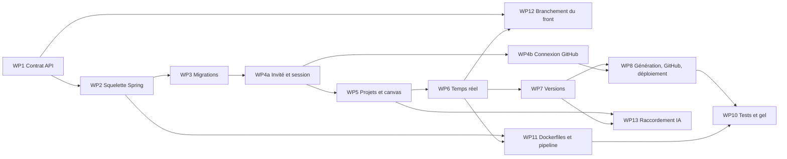

# Feuille de route du backend

> Dernière mise à jour : 2026-10-20 (J-4 avant la soumission visée du samedi 24 octobre, midi).
>
> **État au 21/10 et reste à faire : voir [AUDIT-ET-ROADMAP-BACKEND.md](AUDIT-ET-ROADMAP-BACKEND.md).** Le « point de situation » du § 2 et les cases des lots ci-dessous datent du 20/10 ; ce document reste la référence des contrats (§ 7) et des décisions (§ 11).
>
> **Périmètre :** API Spring Boot, serveur temps réel (Hocuspocus), base PostgreSQL, Dockerfiles et déploiement de Lonkoo, branchement du front.
> **Hors périmètre : l'agent IA** (Serine Fallou Ngom). Seuls ses points de raccordement sont prévus (§ 9).
>
> Les dates et priorités viennent de [BACKLOG-INITIAL.md](BACKLOG-INITIAL.md), les choix techniques de [architecture.md](architecture.md). Les écarts et décisions à confirmer sont au § 11.
> Ce document décrit l'état du dépôt `Pouye15/Lonkoo` (branches `main` et `chore/structure`). Si du travail existe ailleurs (VPS, pipeline, branches locales), le § 2 est à corriger.

## 1. En bref

1. **Le backend et le temps réel n'existent pas encore** (`backend/` et `realtime/` ne contiennent que `.gitkeep`), alors que le backlog prévoyait le squelette le 17/10 et le temps réel le 19/10. Il reste environ 35 heures de travail utile avant le gel du 23/10 (estimation à 10 h par jour) : le plan est donc construit autour d'**une tranche verticale** livrée d'abord (invité, projet, canvas, temps réel, version), puis élargie.
2. **Chemin critique :** contrat d'API, squelette, connexion invité, canvas, ticket temps réel, serveur Hocuspocus, versions. La connexion GitHub, les liens de partage et la sécurité transverse se font en parallèle ou juste après.
3. **Rien n'est déployé à ce jour** (aucun Dockerfile, pas de `docker-compose.prod.yml`) alors que « projet en ligne » est une condition de recevabilité. Le backend livre donc un `Dockerfile` dès le premier jour pour que le squelette soit déployé par le pipeline avant jeudi.
4. **Trois décisions à prendre aujourd'hui** (§ 11) : qui convertit Yjs en JSON (le JVM ne sait pas lire l'état Yjs), comment le front adopte les 8 types de blocs du contrat, comment deux jurés éditent le même canvas sans compte (liens de partage).
5. **Ordre de coupe** si le temps manque : membres et rôles fins, comparaison visuelle de versions, partage en lecture seule, déploiement des applications générées (plan B du déploiement). Le parcours invité, canvas, temps réel, version, génération et GitHub ne se coupe pas.

## 2. Point de situation au 20/10

| Élément | État dans le dépôt | Prévu au backlog | Écart |
|---|---|---|---|
| `backend/` | Spring Boot 4.1 : invités, session, projets, canvas, partage, ticket temps réel, versions, validateur ; 71 tests (21/10) | squelette Spring Boot : 17/10 | fait ; restent la connexion GitHub, la génération et le déploiement ([AUDIT-ET-ROADMAP-BACKEND.md](AUDIT-ET-ROADMAP-BACKEND.md)) |
| `realtime/` | serveur Hocuspocus : tickets, persistance, instantané et restauration, lecture seule ; 31 tests (21/10) | serveur Hocuspocus et tickets : 19/10 | fait |
| `docs/openapi.yaml` | écrit et validé en CI (21/10) ; les routes GitHub, IA, génération et déploiement restent à coder | 17/10 (Pouye avec Fall) | fait pour les routes codées |
| `infra/` | `Caddyfile` et `docker-compose.dev.yml` (base seule) ; Dockerfiles du backend et du temps réel écrits (construits par la CI) ; pas de compose de production | squelette en ligne en HTTPS : 18/10 | à confirmer avec Diagne et Gaye |
| `frontend/` | **importé** depuis `Gnatam/Lonkoo-frontend` avec son historique, puis finitions du 20/10 : connexion (GitHub ou invité, simulée), thème sombre, shell par projet, tableau blanc façon draw.io ; données gardées dans le navigateur, **aucun appel d'API** ; lint, build et licences passent | canvas React Flow et 8 types de blocs : 20/10 (Fall) | canevas maison (pas React Flow) et modèle de blocs différent du contrat (§ 11, D2) |
| Contrat du canvas | fait (`schema-canvas.md`, `canvas.schema.json`, exemple validé par la CI) | 16/10 | aucun |
| CI | active : lint, build et tests du front, du backend (avec test de chaîne) et du temps réel ; licences npm et Maven bloquantes ; construction des images Docker ; avis de sécurité (informatif) ; validation du contrat d'API | | à confirmer au premier push |
| Poste de développement | JDK 25, Maven 3.9, Node 22, Python 3.12 ; **Docker absent, virtualisation inactive** | Java 21, Node 24, Docker | voir WP0 |

## 3. Périmètre

| Dans le périmètre | Hors périmètre |
|---|---|
| Comptes : connexion GitHub, invité éphémère, session serveur | Agent IA, serveur MCP, quotas et appels au modèle (colleague) |
| Projets, canvas, droits d'accès, liens de partage | Fournisseur et modèle d'IA, validation des sorties de l'IA (sauf la fonction de validation partagée) |
| Serveur temps réel (Hocuspocus), tickets, persistance de l'état | Génération de la documentation, ADR, simulateur (IA ou front) |
| Versions nommées, restauration, validation du JSON du canvas | Communauté (galerie, abonnés), revues d'architecture, Orion : aucune route prévue (le front les garde en démonstration, § 8) |
| Génération du projet, envoi sur GitHub, déploiement (Gaye ; le backend fournit les fondations) | SystaDrive, undo/redo, commentaires ancrés, galerie publique (« à couper » du backlog) |
| Journal d'audit, limites d'usage, sécurité transverse | |
| Dockerfiles, compose de production, pipeline de déploiement de Lonkoo (Gaye, Diagne) | |
| Branchement du front sur l'API (remplacer les données fictives) | |

## 4. Principes d'ordonnancement

1. **Tranche verticale d'abord.** Un invité peut ouvrir le modèle d'exemple, deux navigateurs voient la même modification, on enregistre puis restaure une version. Tout le reste s'ajoute à cette base.
2. **Débloquer les autres avant d'être complet.** Le contrat d'API, la connexion invité et les routes de canvas passent en premier : Fall branche le front, Gaye lit des instantanés, Ngom reçoit ses points de raccordement.
3. **Déployable à tout moment.** Chaque lot arrive sur `main` en laissant `main` déployable (règle de `CONTRIBUTING.md`). Pull requests de moins de 300 lignes quand c'est possible, une par lot.
4. **Couper tôt, couper proprement.** À chaque fin de journée on compare l'avancement au plan ; ce qui glisse de plus d'une demi-journée passe dans la liste du § 10.

### Flux git

- La branche `backend` a été créée depuis `chore/structure`. Elle contient le monorepo, le front importé **avec son historique** (`git subtree`, sans squash : les commits de Fall restent) et ce document.
- Ordre conseillé : (1) fusionner `chore/structure` dans `main` (aujourd'hui `main` ne contient que le commit initial) ; (2) une pull request `backend` vers `main` pour l'import du front et ses finitions : volumineuse mais lisible commit par commit, à faire relire par Fall ; (3) ensuite un lot du § 6 par branche `feature/backend-<lot>` créée depuis `main`, avec une pull request de moins de 300 lignes quand c'est possible.
- Pour renvoyer les évolutions du front vers `Gnatam/Lonkoo-frontend` si l'équipe le souhaite : `git subtree push --prefix=frontend origin <branche>`. Sinon ce dépôt devient la seule source du front (décision de l'équipe).

## 5. Plan jour par jour

Durées en heures de travail focalisé, avec assistance IA, hors pauses ; marge de 30 % non incluse. Total pour le backend (Pouye) : environ 37 h.

| Jour | Objectif | Lots | Ce qui doit marcher le soir |
|---|---|---|---|
| **Mar 20/10** (J0) | Squelette et invité | WP0, WP1, WP2, WP3, WP4a, début de WP5 | `curl` : invité, puis projet, puis canvas ; `/api/actuator/health` répond ; contrat d'API publié ; `Dockerfile` du backend écrit (construit par la CI tant que Docker manque en local) |
| **Mer 21/10** (J1) | Temps réel, versions, GitHub | fin de WP5, WP6, WP7, WP4b, liens de partage, WP13 | deux navigateurs éditent le même canvas et la modification survit au redémarrage ; version créée puis restaurée ; connexion GitHub locale ; Gaye peut lire un instantané |
| **Jeu 22/10** (J2) | En ligne et bout en bout | WP11, WP9, WP12 | parcours complet sur l'adresse de production : invité, canvas, version, génération, envoi GitHub (déploiement des applications : plan B si besoin) |
| **Ven 23/10** (J3) | Gel du périmètre | WP10, correctifs | tests de fumée et test de bout en bout verts en production ; licences, SBOM, sauvegarde et redémarrage vérifiés ; démo de secours enregistrée |
| **Sam 24/10** (J4) | Soumission | déploiement final | déclarations, README, dépôt propre, soumission avant midi |

Dépendances externes à lever tout de suite : achat du VPS et du domaine (Diagne), création des deux applications OAuth GitHub (Pouye, WP0), choix du fournisseur d'IA (Ngom, échéance dépassée du 17/10), accès SSH et Docker sur le VPS (Gaye).



## 6. Lots de travail

Convention : `[ ]` à faire, responsable et jour entre parenthèses (proposition issue du backlog, à valider). Chaque lot se termine par une **preuve** vérifiable.

### WP0 — Poste et dépôt (Pouye, J0, 1 h)

- [ ] **Base de données locale.** Ce poste n'a pas `docker` et Windows n'y montre pas de virtualisation active (`HypervisorPresent` faux) : Docker Desktop risque de ne pas démarrer sans l'activer dans le BIOS. Plan par défaut : **PostgreSQL 16 natif** (installeur EDB, 15 min) avec les mêmes identifiants que `docker-compose.dev.yml`, et `io.zonky.test:embedded-postgres` (Apache 2.0) pour les tests locaux. Si la virtualisation s'active : Docker Desktop. Autre repli : GitHub Codespaces (le dépôt a déjà un `.devcontainer`).
- [ ] Java : installer Temurin 21 (le poste a JDK 25 ; compiler avec `maven.compiler.release=21` fonctionne, mais lancer les tests sous 21 comme la CI). Node 24 LTS recommandé (Node 22 suffit pour travailler).
- [ ] `pip install pre-commit && pre-commit install` (gitleaks et blocage des commits sur `main`, `CONTRIBUTING.md`).
- [ ] `cp .env.example .env`, générer les secrets (`openssl rand -base64 32`) pour `POSTGRES_PASSWORD`, `REALTIME_TICKET_SECRET`, `REALTIME_SERVICE_TOKEN`.
- [ ] Créer **deux applications OAuth GitHub** sur le compte du propriétaire du dépôt (une application OAuth n'accepte qu'une seule adresse de retour) : développement `http://localhost:3000/api/auth/github/callback`, production `https://<domaine>/api/auth/github/callback`. Portées demandées plus tard : `read:user` et `public_repo`.

**Preuve :** `docker compose -f infra/docker-compose.dev.yml --env-file .env up -d` puis `psql` se connecte à la base.

### WP1 — Contrat d'API (Pouye avec Fall, J0, 2 h)

- [ ] Écrire `docs/openapi.yaml` (v0) à partir du § 7.1 : schémas, erreurs `application/problem+json`, authentification par cookie de session, exemples. Routes IA et génération incluses mais marquées « non implémentées ».
- [ ] Merger la pull request tout de suite (Fall, Gaye et Ngom relisent ce qui les concerne).
- [ ] Fall génère les types du front depuis ce fichier (`openapi-typescript`, MIT) pour éviter toute dérive.
- [ ] Ajouter la validation de `openapi.yaml` au job « Contrat du canvas » de la CI (`openapi-spec-validator`, Apache 2.0).

**Preuve :** pull request fusionnée ; le front n'a plus à demander la forme d'une réponse.

### WP2 — Squelette Spring Boot (Pouye, J0, 2 h)

- [ ] Générer le projet (start.spring.io : Java 21, Maven, Spring Boot 4.1.x ; Web, Security, Validation, Actuator, JDBC, Flyway, PostgreSQL). Exclure `spring-boot-starter-logging` et ajouter `spring-boot-starter-log4j2` (décision d'architecture). Attention : Spring Boot 4 découpe l'autoconfiguration en modules et passe à Jackson 3 (`tools.jackson`) ; les tutoriels Boot 3 demandent des adaptations (§ 10, risque 5).
- [ ] Wrapper Maven (`mvn wrapper:wrapper`) ; le `.gitignore` autorise `maven-wrapper.jar`.
- [ ] Profils `dev` et `prod`. Refuser de démarrer si une valeur `change-me` subsiste **en profil prod** (avertissement en dev) et seulement pour les variables réellement utilisées : `AI_*` n'est contrôlé que si `AI_ENABLED=true`, sinon le backend ne démarrerait pas tant que l'IA n'est pas configurée.
- [ ] Erreurs au format `problem+json` (RFC 9457), identifiant de requête dans les journaux, **aucun corps de requête, cookie ni en-tête `Authorization` journalisé**.
- [ ] Santé sous `/api/actuator/health` (`management.endpoints.web.base-path=/api/actuator`) : Caddy ne route que `/api`, `/ws` et `/`. Les autres points d'Actuator restent désactivés.
- [ ] `backend/Dockerfile` en deux étapes (Maven puis JRE 21), utilisateur non root.
- [ ] Rendre bloquant le contrôle de licences Maven dès ce premier `pom.xml` (backlog) ; noter les dépendances dans `docs/LICENCES-TIERCES.md`.

**Preuve :** `./mvnw verify` passe ; `curl localhost:8080/api/actuator/health` renvoie `UP` ; le job « Backend (Maven) » de la CI est vert.

### WP3 — Base de données (Pouye, J0, 1 h)

- [ ] Migrations Flyway dans `backend/src/main/resources/db/migration`. **Plages de versions par personne** pour éviter les collisions : `V1` à `V9` socle (Pouye), `V10` à `V19` génération et déploiement (Gaye), `V20` à `V29` IA (Ngom).
- [ ] `V1__socle.sql` (users, projects, project_members, canvases, canvas_states) et `V2__versions_partage_audit.sql` : voir le schéma au § 7.4.
- [ ] Tâche planifiée quotidienne qui supprime les invités expirés (les projets partent en cascade).

**Preuve :** démarrage sur une base vide, puis redémarrage sans erreur Flyway.

### WP4a — Session et invité (Pouye, J0, 3 h)

- [ ] `POST /api/auth/guest` : crée un invité éphémère (24 h), un projet « Démo » et un canvas dont `seed_snapshot` est le modèle `docs/exemples/marketplace-mobile.canvas.json` (copie placée dans les ressources du backend et **validée au démarrage** contre le schéma).
- [ ] Session serveur, cookie `HttpOnly`, `Secure` (hors dev), `SameSite=Lax`. *Décision du 16/10 : sessions en mémoire, car Spring Session JDBC aurait écrit le jeton GitHub en base. **Révisée le 25/10** : les sessions sont en base (Spring Session JDBC, migration V13) et le jeton GitHub n'est plus un attribut de session mais vit dans `GithubTokenStore`, en mémoire du serveur : la règle de fond (jamais de jeton en base) est gardée, et un redémarrage ne déconnecte plus personne.*
- [ ] `GET /api/me`, `POST /api/auth/logout`.
- [ ] Protection contre les requêtes intersites : pour `POST`, `PUT`, `PATCH` et `DELETE`, refuser si l'en-tête `Origin` (ou à défaut `Referer`) n'est pas celui de `APP_PUBLIC_URL`.
- [ ] Limite d'usage par adresse sur `/auth/guest` (par exemple 20 par heure, compteur en mémoire) ; derrière Caddy, activer `server.forward-headers-strategy` pour lire la vraie adresse.
- [ ] Journal d'audit : `guest.created`, `login`, `logout`.

**Preuve :** `curl -c jar -X POST /api/auth/guest` puis `curl -b jar /api/me` renvoie l'invité ; sans cookie, `401` ; avec un mauvais `Origin`, `403`.

### WP4b — Connexion GitHub (Pouye, J1, 3 h)

- [ ] Flux OAuth côté serveur : `GET /api/auth/github/login` (paramètre `state` conservé en session), `GET /api/auth/github/callback` (vérifie `state`, échange le code, lit `GET /user`, crée ou met à jour `users`, ouvre la session, redirige vers `APP_PUBLIC_URL/dashboard`).
- [ ] Le jeton GitHub reste **en mémoire du serveur uniquement** (jamais en base, jamais dans les journaux, jamais un attribut de la session qui, elle, est en base) ; il est exposé aux services de génération par une interface (`GithubSession.token()`).
- [ ] Choix d'implémentation (30 min au plus) : soit `oauth2Login` de Spring Security avec adresses personnalisées sous `/api`, soit échange manuel avec `RestClient` (environ 100 lignes, aucune dépendance supplémentaire). Dans les deux cas, ne rediriger que vers des adresses fixes (pas de redirection ouverte).
- [ ] Un invité qui se connecte avec GitHub **rattache** son compte (ses projets sont conservés) au lieu d'en créer un second.
- [ ] Journal d'audit : `login.github`.

**Preuve :** en local, le bouton « Continuer avec GitHub » du front aboutit sur `/dashboard` avec `GET /api/me` correct ; la valeur du jeton n'apparaît dans aucun journal ni table.

### WP5 — Projets, canvas, droits (Pouye, fin J0 et début J1, 3 h)

- [ ] `GET/POST /api/projects`, `GET/PATCH/DELETE /api/projects/{id}`, canvas d'un projet (§ 7.1).
- [ ] **Un seul service de contrôle d'accès** (`CanvasAccessService.requireRead/requireWrite(canvasId)`) utilisé par tous les contrôleurs, le ticket temps réel et les futurs appels IA (« chaque route, chaque ticket, chaque appel IA », `architecture.md`).
- [ ] Rôles : on garde les cinq valeurs du front (`OWNER`, `MAINTAINER`, `WRITE`, `TRIAGE`, `READ`) mais seuls quatre niveaux ont un effet : lecture (tous), écriture sur le canvas (`WRITE` et plus), gestion des membres et réglages (`MAINTAINER` et plus), suppression (`OWNER`).
- [ ] **Liens de partage** (nécessaires à la démo temps réel entre deux personnes sans compte) : `POST /api/canvases/{id}/share-links` (rôle `WRITE` ou `READ`, durée au plus 72 h), `POST /api/join/{token}` (crée un invité si besoin et ajoute le membre). Le jeton est aléatoire (32 octets), **stocké sous forme d'empreinte SHA-256**.
- [ ] Journal d'audit : `project.created`, `project.visibility`, `share.created`, `share.joined`.

**Preuve :** un second invité qui ouvre le lien obtient l'accès ; un troisième sans lien reçoit `404` (pas `403`, pour ne pas révéler l'existence du canvas).

### WP6 — Temps réel (Pouye, J1, 5 h)

Backend :
- [ ] `POST /api/canvases/{id}/realtime-ticket` : vérifie l'accès (`requireRead`) et délivre un **ticket JWT HS256 de 5 minutes** (§ 7.3), signé avec `REALTIME_TICKET_SECRET` (`javax.crypto.Mac`, sans dépendance, ou Nimbus Apache 2.0).
- [ ] `GET` et `PUT /internal/canvases/{id}/state` (§ 7.2), protégés par `REALTIME_SERVICE_TOKEN` (comparaison à temps constant) **en plus** du `404` de Caddy sur `/internal/*`.

Serveur `realtime/` (Node 24, `@hocuspocus/server`, `yjs`, `jose` : tous MIT) :
- [ ] `onAuthenticate` : vérifie signature, expiration, audience et que le canvas du ticket est bien `documentName` ; `connection.readOnly = true` pour les rôles lecture ; renvoie le contexte (utilisateur, rôle).
- [ ] `onLoadDocument` : charge l'état depuis le backend ; s'il n'y en a pas, **initialise le document depuis `seed`** (modèle d'exemple) en suivant la correspondance Yjs de `schema-canvas.md`.
- [ ] `onStoreDocument` (avec `debounce` de 3 s et `maxDebounce` de 15 s) : réécrit l'état via `PUT /internal/...` ; enregistrement immédiat quand le dernier client se déconnecte. Présence et curseurs (*awareness*) ne sont jamais enregistrés.
- [ ] Routes HTTP internes pour le backend (§ 7.2) : instantané JSON et restauration (voir D1, § 11).
- [ ] Gérer l'échec du backend sans perdre le document en mémoire (nouvelle tentative), limiter la taille des messages.
- [ ] `realtime/Dockerfile` (Node 24, utilisateur non root) et `npm test`.
- [ ] Test automatisé **sans Docker** : un faux backend HTTP, deux `HocuspocusProvider`, vérifier la synchronisation, le rejet d'un mauvais ticket et le mode lecture seule.

À vérifier dans la version installée : renouvellement du ticket à la reconnexion (le `token` du provider accepte-t-il une fonction ?), `openDirectConnection` pour modifier un document côté serveur (restauration).

**Preuve :** deux navigateurs sur le même canvas voient curseurs et modifications ; redémarrage du serveur temps réel puis rechargement : le contenu est conservé ; un ticket expiré ou falsifié est refusé.

### WP7 — Versions (Pouye, J1, 3 h)

- [ ] Fonction de validation **partagée** `CanvasValidator` : schéma `canvas.schema.json` (`com.networknt:json-schema-validator`, Apache 2.0, brouillon 2020-12) **plus** les règles que le schéma ne peut pas exprimer (`schema-canvas.md` : identifiants uniques, liens vers des blocs existants, noms uniques, mots réservés Java, SQL et YAML). Tests avec l'exemple et des cas invalides. Même fonction pour l'instantané, l'import et, plus tard, la sortie de l'IA.
- [ ] `POST /api/canvases/{id}/versions` : demande l'instantané au serveur temps réel (D1), valide, enregistre dans `canvas_versions` (nom, message, auteur). Refuser avec `422` et le détail des erreurs si invalide.
- [ ] `GET /api/canvases/{id}/versions` et `GET .../{versionId}` (instantané, utile au générateur et à la comparaison).
- [ ] `POST .../{versionId}/restore` : demande au serveur temps réel d'appliquer l'instantané **dans la transaction du document** (les clients connectés voient le changement sans se reconnecter). Écrire le journal d'audit (`version.restored`).
- [ ] `GET /api/canvases/{id}/snapshot` : instantané courant (pour l'export JSON, le générateur et l'IA).

**Preuve :** créer une version, modifier le canvas, restaurer : le canvas revient à l'état enregistré chez tous les clients connectés ; un instantané invalide est rejeté avec `422`.

### WP8 — Génération, envoi sur GitHub, déploiement (Gaye ; Pouye relit et fournit les fondations, J1 à J2)

Le backend fournit à Gaye : l'instantané validé (WP7), l'accès au jeton GitHub de la session (WP4b), la table `audit_log`, les contrôles d'accès. Pistes pour éviter les pièges connus :

- [ ] **Génération** (`POST /api/canvases/{id}/generate`, asynchrone, `202`) : gabarits fixes (Mustache ou FreeMarker, Apache 2.0), seuls les `ident` validés entrent dans le code ; sortie : projet Spring Boot ou Next.js, `openapi.yaml`, `Dockerfile`, `docker-compose.yml`, README avec Mermaid. Tests sur l'exemple `marketplace-mobile`.
- [ ] **Envoi sur GitHub** (`POST /api/generations/{id}/push-github`) : `POST /user/repos` (dépôt **public**, car la portée est `public_repo`) avec `auto_init: true`, puis un seul commit via l'API Git (arbre avec contenus, commit, mise à jour de la référence). Sur un dépôt vide, l'API Git répond `409` : l'initialisation (`auto_init` ou `PUT /contents`) évite le problème, et un `409` juste après la création peut demander une courte nouvelle tentative.
- [ ] **Déploiement** (`POST /api/generations/{id}/deploy`, `GET /api/deployments/{id}`) : SSH puis `docker compose` avec gabarit fixe, limites de mémoire et de processeur, conteneurs sans privilèges ni montage de l'hôte. Bibliothèque SSH à licence permissive (Apache MINA SSHD, Apache 2.0, ou `mwiede/jsch`, licence BSD) ou binaire `ssh` appelé **sans shell** avec arguments séparés. États : `PENDING`, `RUNNING`, `DEPLOYED`, `FAILED`. Plan B si non prêt au gel : l'interface affiche les commandes à exécuter à la main (`DEPLOIEMENT.md`).
- [ ] Journal d'audit : `generate`, `push.github`, `deploy` ; migrations `V10` à `V19`.

**Preuve :** l'exemple `marketplace-mobile` produit un dépôt GitHub qui compile et démarre avec `docker compose up`.

### WP9 — Sécurité transverse (Pouye avec Diagne, J2, 3 h)

- [ ] En-têtes de sécurité côté API et vérification des en-têtes du front (la CSP de `frontend/next.config.ts` n'autorise que `'self'` ; en dev, `ws:` est ouvert pour le temps réel).
- [ ] Limites d'usage (versions, génération, envoi GitHub) par utilisateur ; invités plus restreints (décision du 16/10 : IA, envoi GitHub et déploiement limités).
- [ ] Revue du journal : aucune valeur de jeton, secret ni contenu de canvas ; `audit_log` en ajout seul.
- [ ] Tailles maximales (corps de requête, état Yjs, instantané), délais d'attente pour les appels sortants (GitHub, SSH, serveur temps réel).
- [ ] Vérification des accès : chaque route a un test « non connecté », « autre utilisateur » et « mauvais rôle ».
- [ ] Rotation des secrets avant la soumission ; aucune valeur `change-me` en production.

### WP10 — Tests, qualité, conformité (Diagne avec Pouye, J3, en continu)

- [ ] **Trois tests de fumée** (`architecture.md`) : (1) invité puis ouverture du modèle ; (2) deux navigateurs, même modification (test Node de WP6 ; vérification manuelle en production) ; (3) version puis restauration (test d'intégration backend avec Testcontainers, MIT, qui fonctionne dans la CI mais pas sur ce poste sans Docker).
- [ ] **Un test de bout en bout** (Playwright, Apache 2.0) sur l'adresse de production.
- [ ] Tests d'accès de WP9 ; tests du validateur et du contrat d'API.
- [ ] Audit des licences Maven (rapport de la CI), mise à jour de `docs/LICENCES-TIERCES.md`. SBOM npm et Maven : **fait le 25/10** (`docs/sbom/`, `scripts/make_sbom.py`, job CI « SBOM des composants »).
- [ ] Sauvegarde `pg_dump` quotidienne et **restauration testée** ; redémarrage du serveur : tout repart seul, les données sont conservées (les sessions sont en base : personne n'est déconnecté ; seul le jeton GitHub est perdu, il faut reconnecter GitHub avant un envoi).

### WP11 — Dockerfiles, compose de production, pipeline (Gaye et Diagne ; Pouye fournit les images, J0 à J2)

- [ ] `backend/Dockerfile` (WP2), `realtime/Dockerfile` (WP6), `frontend/Dockerfile` (`output: "standalone"` dans `next.config.ts`, Node 24, utilisateur non root). Attention : `frontend/` n'a plus de dossier `public/` (les images de la vidéo d'accueil ont été retirées) : ne pas faire de `COPY public` sans le recréer ; `next/font/google` télécharge les polices pendant le build, qui a donc besoin d'Internet.
- [ ] `infra/docker-compose.prod.yml` : Caddy, frontend, backend, realtime, PostgreSQL (sans port publié, volume nommé, `healthcheck`, `restart: unless-stopped`, réseau interne, secrets lus dans le `.env` du serveur).
- [ ] Pipeline de déploiement A (`DEPLOIEMENT.md`, étape 3) avec vérification de `https://<domaine>/api/actuator/health`.
- [ ] Question restante pour l'organisateur : les images de base (Temurin, Debian, Alpine) relèvent-elles du périmètre de la règle sur les licences (`QUESTIONS-ORGANISATEUR.md`) ?

**Preuve :** une fusion dans `main` met en ligne la version suivante sans intervention manuelle.

### WP12 — Branchement du front (Fall avec Pouye, J1 à J2)

- [ ] Session : `frontend/src/lib/session.tsx` contient déjà l'adaptateur API (`POST /auth/guest`, `GET /auth/github/login`, `GET /me`, `POST /auth/logout`) ; il n'a pas pu être testé faute de backend. Le front l'active avec `NEXT_PUBLIC_API_MODE=live` au **build**.
- [ ] Variables du front : Next lit `frontend/.env.local` (pas le `.env` de la racine) et inline les `NEXT_PUBLIC_*` au build. Copier `NEXT_PUBLIC_API_MODE`, `NEXT_PUBLIC_API_URL` et `NEXT_PUBLIC_REALTIME_URL` dans `frontend/.env.local` en développement, et les passer en arguments de build dans le Dockerfile du front.
- [ ] Projets : remplacer `frontend/src/lib/workspace.tsx` (données locales) par `GET/POST/PATCH /projects` ; retirer des écrans les champs fictifs sans équivalent (voir § 8).
- [ ] Canvas : `HocuspocusProvider` + Yjs selon la correspondance de `schema-canvas.md` ; curseurs et présence (*awareness*) ; ticket via `POST .../realtime-ticket` ; mode lecture seule.
- [ ] Versions : créer, lister, restaurer ; export JSON via `GET .../snapshot`.
- [ ] Gestion propre des `401` (retour à la connexion) et des erreurs `problem+json`.
- [ ] En dev : `NEXT_PUBLIC_REALTIME_URL=ws://localhost:1234` (la CSP de développement l'autorise) ; en production : chemin relatif `/ws`.

### WP13 — Raccordement de l'agent IA (Pouye, J1, 1,5 h ; le reste appartient à Ngom)

Détail au § 9.

## 7. Contrats techniques

### 7.1 API publique (sous `/api`, version 0 à écrire dans `openapi.yaml`)

Tranches : **T1** indispensable, **T2** important, **T3** à couper en premier.

| Domaine | Route | Accès | Corps → réponse | Tranche |
|---|---|---|---|---|
| Session | `GET /auth/github/login` | public | redirection vers GitHub | T1 |
| | `GET /auth/github/callback` | public | échange du code, session, redirection | T1 |
| | `POST /auth/guest` | public, limité par adresse | → `201` `Me` | T1 |
| | `POST /auth/logout` | session | → `204` | T1 |
| | `GET /me` | session | → `{id, login, displayName, avatarUrl, isGuest}` | T1 |
| Projets | `GET /projects` | session | → projets dont je suis membre | T1 |
| | `GET /projects/public` | session | → galerie : projets publics de comptes GitHub (`?limit=`, 24 par défaut, 50 au plus) | T3 |
| | `POST /projects` | session | `{name, description?, visibility?}` → `201` (avec un canvas vide) | T1 |
| | `GET/PATCH /projects/{id}` | membre, ou toute personne connectée si le projet est public (lecture seule) ; `PATCH` : `MAINTAINER`+, la visibilité `OWNER` | nom, description, visibilité | T1 |
| | `DELETE /projects/{id}` | `OWNER` | → `204` | T2 |
| | `GET/PUT/DELETE /projects/{id}/members[/{userId}]` | `MAINTAINER`+ | membres et rôles | T3 |
| Canvas | `GET /projects/{id}/canvases`, `POST /projects/{id}/canvases` | membre ; `WRITE`+ | → canvas | T1 |
| | `GET /canvases/{id}` | membre | métadonnées et rôle de l'appelant | T1 |
| | `POST /canvases/{id}/realtime-ticket` | membre | → `{ticket, expiresAt, role, user:{name, color}}` | T1 |
| | `GET /canvases/{id}/snapshot` | membre | → JSON du contrat (état courant) | T1 |
| Partage | `POST /canvases/{id}/share-links` | `MAINTAINER`+ | `{role, ttlHours}` → `{url, expiresAt}` | T1 |
| | `POST /join/{token}` | public (invité créé si besoin) | → `{projectId, canvasId}` | T1 |
| Versions | `GET /canvases/{id}/versions` | membre | liste | T1 |
| | `POST /canvases/{id}/versions` | `WRITE`+ | `{name, message?}` → `201` ; `422` si invalide | T1 |
| | `GET /canvases/{id}/versions/{versionId}` | membre | → instantané | T1 |
| | `POST /canvases/{id}/versions/{versionId}/restore` | `WRITE`+ | → `204` | T1 |
| IA (point de raccordement, § 9) | `POST /canvases/{id}/ai/sketch`, `/ai/complete` (`WRITE`+), `/ai/audit` (membre) | droit sur le canvas ; quota à poser | une proposition validée, ou des remarques ; `501` tant qu'aucun fournisseur n'est branché | fait le 25/10 |
| Génération | `POST /canvases/{id}/generate` | `WRITE`+ | `{versionId?, target}` → `202 {generationId}` | T2 |
| | `GET /generations/{id}` | membre | état, liste de fichiers | T2 |
| | `POST /generations/{id}/push-github` | session GitHub | `{repoName}` → `202` | T2 |
| | `POST /generations/{id}/deploy` | `WRITE`+ | → `202 {deploymentId}` | T2 |
| | `GET /deployments/{id}` | membre | `{status, url?}` | T2 |
| Santé | `GET /actuator/health` | public | `{"status":"UP"}` | T1 |

Règles communes : erreurs `application/problem+json` ; `404` plutôt que `403` quand l'appelant ne devrait pas connaître l'existence d'une ressource ; toute écriture vérifie le rôle **côté serveur** ; identifiants en UUID ; aucune donnée sensible dans les URL.

### 7.2 API interne entre le serveur temps réel et le backend

Réseau interne uniquement, jamais routée par Caddy, jeton de service `Authorization: Bearer <REALTIME_SERVICE_TOKEN>`.

| Sens | Route | Rôle |
|---|---|---|
| realtime → backend | `GET /internal/canvases/{id}/state` | → `{state: "<base64>"\|null, seed: {…}\|null}` : `state` si un état existe, sinon `seed` (modèle initial) |
| realtime → backend | `PUT /internal/canvases/{id}/state` | `{state: "<base64>"}` → `204` ; l'état Yjs est un binaire de quelques dizaines de Ko (JSON avec base64 : plus simple à déboguer que de l'`octet-stream`) |
| backend → realtime | `GET {REALTIME_INTERNAL_URL}/internal/canvases/{id}/snapshot` | → instantané JSON du contrat, construit depuis le document Yjs |
| backend → realtime | `POST {REALTIME_INTERNAL_URL}/internal/canvases/{id}/restore` | instantané JSON → remplace le contenu du document en transaction, `204` |
| backend → realtime | `POST {REALTIME_INTERNAL_URL}/internal/canvases/{id}/close` | ferme les connexions ouvertes sur ce canvas (projet supprimé), `204` ; avec le corps `{"userId": "…"}` (membre retiré ou parti), ferme seulement celles de cette personne et refuse les tickets qu'elle détient déjà ; avec `{"exceptUserIds": ["…"]}` (projet public repassé en privé), celles de tous sauf ces membres |
| supervision → realtime | `GET /health` (sans jeton) | `200 {"status":"UP"}`, `503` pendant l'arrêt |

`REALTIME_INTERNAL_URL` (par exemple `http://realtime:1234`) est à ajouter à `.env.example`.

### 7.3 Ticket du temps réel

JWT compact HS256, durée de vie de 5 minutes, délivré par le backend, vérifié dans `onAuthenticate` (le ticket est envoyé dans le message d'authentification du provider, pas dans l'URL).

```json
{
  "iss": "lonkoo-backend",
  "aud": "lonkoo-realtime",
  "sub": "<userId>",
  "cid": "<canvasId>",
  "role": "WRITE",
  "name": "Aminata",
  "color": "#1265DD",
  "iat": 1760961600,
  "exp": 1760961900
}
```

Vérifications : signature, `exp`, `aud`, et `cid` égal au `documentName` ouvert. `role` valant `READ` ou `TRIAGE` donne `connection.readOnly = true`. Une modification de droits ne prend effet qu'au prochain ticket (5 minutes au plus) : acceptable, à noter dans la soumission.

### 7.4 Schéma SQL de départ

```sql
-- V1__socle.sql
create table users (
  id           uuid primary key default gen_random_uuid(),
  github_id    bigint unique,                      -- null pour un invité
  login        varchar(64) not null,
  display_name varchar(120),
  avatar_url   text,
  is_guest     boolean not null default false,
  expires_at   timestamptz,                        -- invités : purge planifiée
  created_at   timestamptz not null default now(),
  constraint users_identite check (is_guest or github_id is not null)
);

create table projects (
  id          uuid primary key default gen_random_uuid(),
  name        varchar(80) not null,
  description varchar(500),
  visibility  varchar(10) not null default 'private' check (visibility in ('private', 'public')),
  owner_id    uuid not null references users (id) on delete cascade,
  created_at  timestamptz not null default now(),
  updated_at  timestamptz not null default now()
);

create table project_members (
  project_id uuid not null references projects (id) on delete cascade,
  user_id    uuid not null references users (id) on delete cascade,
  role       varchar(12) not null check (role in ('OWNER', 'MAINTAINER', 'WRITE', 'TRIAGE', 'READ')),
  created_at timestamptz not null default now(),
  primary key (project_id, user_id)
);

create table canvases (
  id            uuid primary key default gen_random_uuid(),
  project_id    uuid not null references projects (id) on delete cascade,
  name          varchar(80) not null,
  seed_snapshot jsonb,                             -- contenu initial, lu par le temps réel au premier chargement
  created_at    timestamptz not null default now()
);

create table canvas_states (
  canvas_id  uuid primary key references canvases (id) on delete cascade,
  state      bytea not null,                       -- état Yjs
  updated_at timestamptz not null default now()
);

-- V2__versions_partage_audit.sql
create table canvas_versions (
  id             uuid primary key default gen_random_uuid(),
  canvas_id      uuid not null references canvases (id) on delete cascade,
  name           varchar(80) not null,
  message        varchar(500),
  schema_version int not null default 1,
  snapshot       jsonb not null,                   -- validé par canvas.schema.json
  author_id      uuid references users (id) on delete set null,
  created_at     timestamptz not null default now()
);
create index canvas_versions_par_canvas on canvas_versions (canvas_id, created_at desc);

create table share_links (
  token_hash char(64) primary key,                 -- SHA-256 du jeton, jamais le jeton
  canvas_id  uuid not null references canvases (id) on delete cascade,
  role       varchar(12) not null check (role in ('WRITE', 'READ')),
  expires_at timestamptz not null,
  created_by uuid references users (id) on delete set null,
  created_at timestamptz not null default now()
);

create table audit_log (
  id       bigint generated always as identity primary key,
  at       timestamptz not null default now(),
  actor_id uuid,                                   -- pas de clé étrangère : le journal survit à la purge des invités
  action   varchar(40) not null,
  target   varchar(80),
  detail   jsonb                                   -- jamais de jeton ni de contenu sensible
);
```

`V10` : `generations`, `deployments` (Gaye). `V20` : `ai_usage` (Ngom).

### 7.5 Variables d'environnement à ajouter à `.env.example`

| Variable | Rôle |
|---|---|
| `REALTIME_INTERNAL_URL` | adresse du serveur temps réel vue depuis le backend (`http://realtime:1234`) |
| `AI_ENABLED` | `false` par défaut ; tant que l'IA n'est pas prête, le contrôle des valeurs `change-me` ignore `AI_*` |
| `SPRING_PROFILES_ACTIVE` | `dev` ou `prod` |
| `GUEST_TTL_HOURS` | durée de vie d'un invité (24 par défaut) |
| `MAX_PROJECTS_PER_GUEST`, `MAX_PROJECTS_PER_ACCOUNT` | projets créés par invité (20) et par compte GitHub (100) ; au-delà, 409 « Limite atteinte » |
| `MAX_CANVASES_PER_PROJECT`, `MAX_VERSIONS_PER_CANVAS`, `MAX_SHARE_LINKS_PER_CANVAS` | canvas par projet (10), versions par canvas (50), liens de partage actifs par canvas (20) |
| `MAX_SNAPSHOT_BYTES` | taille maximale d'un instantané enregistré par version, en octets (1 048 576) |
| `NEXT_PUBLIC_API_MODE` | `mock` (défaut, déjà dans `.env.example`) ou `live` : le front appelle l'API ; lue au build, dans `frontend/.env.local` |

## 8. Front et backend : correspondances

Le front importé est une maquette navigable : toutes les données viennent de `src/lib/lonkoo-data.ts`, rien n'appelle l'API. Ce qui est branché au backend, ce qui reste une démonstration :

| Écran ou fonction du front | Appels | Tranche | Remarques |
|---|---|---|---|
| Connexion (nouvelle page) | `POST /auth/guest`, `GET /auth/github/login`, `GET /me`, `POST /auth/logout` | T1 | session simulée dans le front, à remplacer (WP12) |
| Projets | `GET/POST/PATCH /projects` | T1 | retirer `aiScore`, `mcpActive`, `orionSynced`, `openReviewsCount`, `forkedFrom` : pas d'équivalent |
| Studio, Architecture | ticket, WebSocket `/ws`, `GET /snapshot` | T1 | modèle de blocs à aligner sur le contrat (D2). Les blocs locaux du contrat (paiement mobile, messagerie, facturation) existent déjà dans la boîte à outils ; le graphe est gardé par projet dans `frontend/src/lib/project-graph.ts`, à remplacer par le document Yjs |
| Studio, Versions | `GET/POST /versions`, restauration | T1 | les « tags Git » du front n'ont pas d'équivalent tant qu'aucune release GitHub n'est créée |
| Studio, Équipe | liens de partage (T1), membres (T3) | T1/T3 | les sous-équipes et la protection de branche n'existent pas côté backend |
| Studio, Analyse IA, Documentation | endpoints IA | — | colleague |
| Studio, Simulateur | aucun | — | calcul local |
| Déploiement | `generate`, `push-github`, `deploy`, `GET /deployments/{id}` | T2 | page à refaire autour de ces trois étapes avec état en direct ; MCP et Orion restent hors périmètre |
| Communauté, Revues, Paramètres (membres, clés MCP), Configuration initiale | aucun | — | données fictives non persistées ; à garder en « démonstration » ou masquer avant la soumission pour ne pas promettre ce qui n'existe pas |

## 9. Raccordement de l'agent IA (hors périmètre, mais prévu)

Ce que le backend fournit à Ngom, pour que l'IA se branche sans toucher au reste :

- [x] `AiClient` : interface unique derrière laquelle vit le fournisseur (`architecture.md`), avec une **implémentation factice** (réponses figées, étiquetées `demo`) pour que le front avance sans clé d'API : `AI_PROVIDER=fake`. Fait le 25/10 (`backend/.../ai/`). Brancher un vrai fournisseur : une classe qui implémente `AiClient`, activée par `lonkoo.ai.provider=<nom>`, rien d'autre à changer.
- [x] Routes `POST /canvases/{id}/ai/sketch`, `/ai/audit`, `/ai/complete` : contrat complet dans `openapi.yaml`, `501` (`AI_NOT_IMPLEMENTED`) tant qu'aucun fournisseur n'est branché (après le contrôle d'accès), un journal d'audit par appel sans le texte saisi, plafond du texte (`AI_MAX_INPUT_CHARS`).
- [x] `CanvasValidator` (WP7) et la lecture de l'instantané courant réutilisés : l'IA reçoit l'instantané courant et **toute sortie est validée** avant d'être renvoyée comme proposition (une proposition invalide donne 502 et n'est pas renvoyée ; les remarques d'audit sur un bloc absent sont écartées et comptées).
- [ ] `CanvasAccessService` (WP5) appliqué aux routes IA : **fait** (écrire demande `WRITE`, l'audit demande d'être membre pour qu'un visiteur d'un projet public ne déclenche pas d'appel payant). **Reste, à Ngom :** le quota par utilisateur et par jour (`AI_DAILY_QUOTA`), qui demande une table `ai_usage` dans la plage `V20` à `V29`.
- [ ] Configuration `AI_*` déjà dans `.env.example`, ignorée par le contrôle de démarrage tant que `AI_ENABLED` vaut `false`.
- [ ] Application d'un patch : passe par le serveur temps réel (`openDirectConnection`, comme la restauration), pas par une écriture directe en base.
- [ ] Hors périmètre ici : le serveur MCP décrit dans `frontend/AGENT.md` (outils `lonkoo_get_architecture`, `lonkoo_apply_patch`, etc.) ; il s'appuiera sur `GET /canvases/{id}/snapshot` et sur l'application de patch ci-dessus.

## 10. Risques et plan de repli

| # | Risque | Probabilité / impact | Parade |
|---|---|---|---|
| 1 | Rien n'est en ligne alors que c'est une condition de recevabilité | élevée / critique | `Dockerfile` du backend dès J0, squelette déployé par le pipeline avant jeudi, déploiement continu ensuite |
| 2 | 37 h de travail pour environ 35 h disponibles | élevée / élevé | ordre de coupe ci-dessous, revue à chaque fin de journée |
| 3 | Le front et le contrat ne parlent pas le même modèle de blocs | élevée / élevé | trancher D2 demain matin au plus tard ; sinon la génération n'a pas de base valide |
| 4 | Le JVM ne sait pas lire l'état Yjs : les versions ne peuvent pas être produites par le backend seul | certaine / élevé | D1 : le serveur temps réel produit et applique les instantanés JSON |
| 5 | Spring Boot 4.1 est récent (starters modulaires, Jackson 3) et moins connu des outils d'aide | moyenne / moyen | limiter à 1 h la prise en main ; repli possible vers Spring Boot 3.5 (hors support depuis le 30/06 mais fonctionnel) si un blocage dure |
| 6 | Docker absent du poste de Pouye et virtualisation inactive | certaine / moyen | WP0 en premier : PostgreSQL 16 natif et `embedded-postgres` pour les tests locaux ; les tests Testcontainers et la construction des images tournent dans la CI ou un Codespace |
| 7 | Une application OAuth GitHub n'accepte qu'une adresse de retour | certaine / faible | deux applications (développement et production), variables d'environnement séparées |
| 8 | Perte de modifications si le serveur temps réel s'arrête entre deux sauvegardes | faible / moyen | `debounce` court, enregistrement à la déconnexion du dernier client, sauvegarde à l'arrêt propre |
| 9 | Génération ou déploiement non prêts au gel du périmètre | moyenne / élevé | plan B de `DEPLOIEMENT.md` : génération et envoi sur GitHub conservés, commandes de déploiement affichées |
| 10 | Licences : JUnit (EPL 2.0, test uniquement), `jakarta.annotation-api` (EPL 2.0 ou GPL 2 avec exception), images Docker | moyenne / élevé | questions déjà dans `QUESTIONS-ORGANISATEUR.md` ; relancer l'organisateur avant jeudi |
| 11 | Dépendance au choix du fournisseur d'IA (échéance dépassée) | élevée / moyen | `AiClient` factice et démo enregistrée (WP13) ; l'IA n'est pas sur le chemin critique du backend |

**Ordre de coupe** (de la première à la dernière chose à abandonner) :
1. API de membres et de rôles fins (garder les liens de partage).
2. Comparaison visuelle de deux versions.
3. Partage en lecture seule par lien et copie de canvas.
4. Déploiement des applications générées (plan B).
5. Limites d'usage détaillées (garder une limite simple par adresse et par utilisateur).

**À ne jamais couper :** validation des instantanés, contrôle d'accès, ticket temps réel, journal d'audit minimal, absence de secrets dans les journaux, sauvegarde et redémarrage.

## 11. Décisions à confirmer et écarts

| # | Sujet | Constat | Recommandation | Qui tranche | Avant |
|---|---|---|---|---|---|
| D1 | **Qui convertit Yjs en JSON ?** | `architecture.md` dit que « le backend lit l'état courant, produit le JSON », mais l'état est un binaire Yjs et nous ne connaissons pas de bibliothèque Yjs mûre côté JVM | le serveur temps réel (Node, qui a Yjs) expose deux routes internes : instantané JSON et restauration (§ 7.2) ; le backend valide et stocke | Pouye, Fall | J0, soir |
| D2 | **Modèle de blocs** | contrat : 8 types (`webapp`, `service`, `database`, `auth`, `queue`, `mobile-payment`, `messaging`, `billing`) avec des `data` précis ; front : 12 formes (`generic`, `gateway`, `cache`, `ai`, `user`, `cylinder`… et les 3 blocs locaux déjà ajoutés) avec `tech`, `port`, débit | le front adopte les 8 types ; ajouter au contrat v1 un type `generic` (bloc libre, ignoré par le générateur) pour garder les blocs sans stack ; correspondance provisoire : `service`→`service`, `cylinder`→`database`, `security`→`auth`, `queue`→`queue`, `user`→`webapp`, le reste→`generic` | Fall, Pouye, Gaye, Ngom (le contrat change par pull request relue par les quatre) | J1, matin |
| D3 | Authentification | le cahier des charges (PDF) parle de **JWT** ; `architecture.md` (16/10) retient une **session serveur** (jeton GitHub jamais dans le navigateur, révocation simple) | garder la session ; le mentionner dans la soumission comme écart assumé | Pouye | — |
| D4 | Santé | `DEPLOIEMENT.md` vérifie `/actuator/health`, mais Caddy ne route que `/api`, `/ws` et `/` | exposer `/api/actuator/health` et corriger `DEPLOIEMENT.md` | Pouye, Gaye | J1 |
| D5 | Collaboration entre jurés | un invité n'a que sa copie du modèle ; deux jurés ne peuvent pas éditer le même canvas | liens de partage en T1 (WP5) ; invitation par identifiant GitHub en T3 | Pouye, Diagne | J0 |
| D6 | Versions Flyway | plusieurs personnes ajoutent des migrations | plages `V1`–`V9`, `V10`–`V19`, `V20`–`V29` | tous | J0 |
| D7 | Contrôle des `change-me` | `.env.example` annonce un refus de démarrer ; cela bloquerait tant que `AI_*` et GitHub ne sont pas renseignés | fatal en profil `prod`, avertissement en `dev`, `AI_*` ignoré si `AI_ENABLED=false` | Pouye | J0 |
| D8 | Déploiement des applications | le PDF prévoit `workflow_dispatch` et GitHub Actions ; `architecture.md` retient SSH depuis le backend (portée `workflow` et clé SSH à confier aux dépôts des utilisateurs sinon) | garder la décision d'architecture, la mentionner comme écart assumé | Gaye | — |
| D9 | Spring Boot | le PDF cite Spring Boot 3 ; `architecture.md` retient 4.1 (support jusqu'au 31/07/2027) | garder 4.1 avec repli 3.5 (risque 5) | Pouye | J0 |
| D10 | Fonctions du front sans backend | communauté, revues, MCP, Orion | garder en démonstration étiquetée ou masquer avant la soumission | Fall, Diagne | J3 |

## 12. Liste de contrôle « prêt pour la démo »

- [ ] Un navigateur sans session arrive sur la page d'accueil et atteint le modèle d'exemple en moins de 30 secondes (compte invité).
- [ ] Deux navigateurs éditent le même canvas via un lien de partage, curseurs visibles.
- [ ] Une version est enregistrée puis restaurée.
- [ ] La connexion GitHub fonctionne sur l'adresse de production (application OAuth de production).
- [ ] Génération, envoi sur GitHub, puis déploiement ou commandes affichées (plan B).
- [ ] Après un redémarrage du serveur, tout repart seul ; les données sont conservées.
- [ ] `pg_dump` quotidien en place et une restauration testée.
- [ ] Aucun secret dans le dépôt (gitleaks) ni dans les journaux ; aucune valeur `change-me` en production.
- [ ] Licences : contrôle npm vert, rapport Maven relu, `docs/LICENCES-TIERCES.md` à jour. SBOM : à jour (la CI échoue si `docs/sbom` ne correspond plus aux dépendances).
- [ ] `docs/IA.md` à jour pour chaque outil d'IA utilisé ; chacun sait expliquer le code qu'il a poussé.
- [ ] Démo de secours enregistrée.
