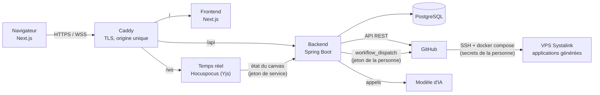

# Architecture

> Document vivant. À mettre à jour à chaque décision importante (ajouter une ligne dans « Décisions prises »).

## Vue d'ensemble

Seuls `/`, `/api` et `/ws` sont exposés. Les routes `/internal` du backend (utilisées par le serveur temps réel) ne sont **pas** routées par Caddy.

## Composants

| Composant | Technologie | Rôle |
|---|---|---|
| Frontend | Next.js, Tailwind CSS (canvas écrit dans le projet) | Canvas interactif, blocs personnalisés, interface |
| Temps réel | Yjs, Hocuspocus (serveur et client) | Synchronisation des modifications, présence et curseurs, authentification par canvas |
| Backend | Spring Boot 4.1 (Java 21), Spring Data JDBC, Flyway, Log4j2 | Comptes, canvas, versions, appels IA, génération, GitHub, déploiement |
| Base de données | PostgreSQL 16 (JSONB) | Comptes, état des canvas, instantanés, journal |
| Proxy | Caddy | TLS automatique, origine unique, pas de CORS |
| IA | [fournisseur à préciser, voir « Décisions ouvertes »] | Esquisse, complétion, audit, sur demande de l'utilisateur |
| Hébergement | Systalink Datacloud (VPS à Dakar) | Application et cible de déploiement |

Le format du canvas est défini dans [schema-canvas.md](schema-canvas.md) et [canvas.schema.json](canvas.schema.json).

## Décisions prises

| Date | Sujet | Choix | Raison |
|---|---|---|---|
| 2026-10-16 | Versions | Java 21 (`maven.compiler.release=21`), Node 24 LTS, Spring Boot 4.1.x, PostgreSQL 16 | Node 20 est hors support depuis le 30/04/2026. Spring Boot 3.5 est hors support depuis le 30/06/2026 et 4.0 s'arrête le 31/12/2026 ; 4.1 est supporté jusqu'au 31/07/2027. |
| 2026-10-16 | Accès aux données | Spring Data JDBC (ou `JdbcClient`) et Flyway, sans JPA | Le modèle est surtout du JSONB. JPA reste permis côté licence (Hibernate 7.4.5, Apache 2.0, géré par Boot 4.1) mais ajoute trois composants EPL (`jakarta.transaction-api`, `aspectjweaver`, `jakarta.persistence-api`). Flyway 12 est sous Apache 2.0. |
| 2026-10-16 | Journaux | Log4j2 : exclure `spring-boot-starter-logging` de `spring-boot-starter` et ajouter `spring-boot-starter-log4j2` | Logback 1.5.x est sous EPL 2.0 ou LGPL 2.1. Avec JDBC et Log4j2, un arbre Spring Boot 4.1.1 complet (web, sécurité, OAuth2, validation, actuator, Flyway) n'a plus qu'une dépendance à examiner (`jakarta.annotation-api`). |
| 2026-10-16 | Serveur temps réel | Hocuspocus (`@hocuspocus/server` et `@hocuspocus/provider`, MIT) | `y-websocket` v3 ne contient plus de serveur. Les hooks `onAuthenticate`, `onLoadDocument` et `onStoreDocument` couvrent l'authentification par canvas et la sauvegarde vers le backend. |
| 2026-10-16 | Données du canvas | Yjs = état courant (binaire) ; JSONB = instantanés nommés ; contrat dans `schema-canvas.md` | L'IA, le générateur et les versions ont besoin d'un JSON stable et validé ; l'édition en direct a besoin d'un CRDT. |
| 2026-10-16 | Origine unique | Caddy devant les trois services (`/`, `/api`, `/ws`) | TLS automatique, `wss`, pas de CORS, cookies simples. Les variables `NEXT_PUBLIC_*` sont des chemins relatifs (elles sont figées au build). |
| 2026-10-16 | Connexion | OAuth GitHub géré par le backend (`/api/auth/github/callback`), session serveur avec cookie `HttpOnly`, `Secure`, `SameSite=Lax` | Le frontend ne manipule jamais de jeton GitHub. |
| 2026-10-16 | Jetons GitHub | Non stockés : gardés **en mémoire du serveur** (à l'origine dans la session ; depuis le 25/10 la session est en base, voir plus bas), perdus au redémarrage. Portées : `read:user` et `public_repo` | `repo` donnerait accès à tous les dépôts privés de l'utilisateur. Limite assumée : les dépôts générés sont publics ; à signaler dans l'interface. |
| 2026-10-16 | Authentification temps réel | Le backend délivre un ticket court (5 minutes) lié à un canvas et à un utilisateur ; Hocuspocus le vérifie dans `onAuthenticate` | Le serveur temps réel ne connaît ni sessions ni base de données. |
| 2026-10-16, révisée avec le lot R8 | Déploiement des applications générées | Le projet généré contient son workflow `.github/workflows/deploy-systalink.yml` ; LONKOO le lance par `workflow_dispatch` dans le dépôt GitHub de la personne, avec son jeton, et suit l'exécution (en attente, en cours, déployé, échoué). Sans les autorisations `repo` et `workflow`, ou sans le fichier, le déploiement passe en **mode manuel** : LONKOO affiche les étapes à suivre soi-même. Le serveur de LONKOO ne se connecte à aucune machine et n'appelle jamais l'adresse publique saisie | C'est ce que décrit le cahier des charges. Le choix initial (SSH depuis le backend) obligeait LONKOO à détenir de quoi atteindre des serveurs d'autres personnes ; ici, hôte et clé SSH sont des secrets du dépôt de la personne, que LONKOO ne voit jamais. Coût assumé : la portée `workflow` est demandée, seulement sur choix explicite. |
| 2026-10-16 | Déploiement de Lonkoo lui-même | GitHub Actions : construction des images, envoi par SSH, `docker compose up -d`, vérification de `/actuator/health` | Les secrets sont dans notre propre dépôt. Voir [DEPLOIEMENT.md](DEPLOIEMENT.md). |
| 2026-10-16 | Génération | Gabarits fixes sans logique ; seuls les identifiants `ident` du schéma entrent dans le code généré | Évite l'injection de code, y compris sur le VPS. Moteur de gabarits à choisir parmi Mustache ou FreeMarker (Apache 2.0) ; vérifier la licence à l'ajout. |
| 2026-10-16 | Stockage de fichiers | Aucun | SystaDrive est introuvable dans l'offre publique ; rien ne l'exige. |
| 2026-10-16 | Compte de démonstration | Invité éphémère créé à la demande, avec une copie du modèle d'exemple. IA, envoi GitHub et déploiement limités | Un compte partagé ferait éditer le même canvas à tous les jurés. |
| 2026-10-16 | Gouvernance GitHub | Dépôt privé sur un compte personnel, sans organisation. Pas de protection de branche (indisponible en offre gratuite) : revue obligatoire par règle d'équipe et hook local `no-commit-to-branch` | Voir `CONTRIBUTING.md`. |
| 2026-10-25 | Sessions | En base (Spring Session JDBC, migration V13) ; le jeton GitHub reste hors de la session, en mémoire du serveur (`GithubTokenStore`). Remplace « sessions en mémoire » du 16/10 | Un déploiement déconnectait tout le monde (et un invité perdait son projet de démonstration). La règle de fond du 16/10, jamais de jeton GitHub en base, est gardée. Limite assumée : après un redémarrage, reconnecter GitHub avant un envoi ; une seule instance du serveur. |
| 2026-10-29 | Fournisseur et architecture de l'IA | Google Gemini (`gemini-3.8-flash`) via un microservice dédié Python `agent_ia` (FastAPI), raccordé au backend Spring Boot par `AgentIaClient` (interface `AiClient`). Ajout d'un assistant conversationnel (Chatbot) d'architecture (`/ai/chat`). | Décision de Serigne Fallou Ngom. `agent_ia` est un service interne isolé (non routé par Caddy, authentification par jeton de service). Validation stricte du schéma et des règles du canvas avec boucle de rattrapage automatique, zéro fuite de secrets, respect des quotas et des délais. |

## Décisions ouvertes

| Sujet | Responsable | Échéance | Critères |
|---|---|---|---|
| ~~Fournisseur et modèle d'IA~~ | Serine Fallou Ngom | Résolu le 29/10/2026 | Google Gemini (`gemini-3.8-flash`) via microservice Python `agent_ia` et raccordement Spring Boot `AgentIaClient`. Chatbot d'architecture inclus. |
| ~~Exposition des applications générées (sous-domaine par projet ou ports)~~ | Gnatam Gaye | Sans objet depuis le lot R8 (25/10) | L'application générée est déployée sur le serveur de la personne, par le workflow de son dépôt : c'est elle qui choisit son adresse. Seule l'adresse de Lonkoo lui-même reste à choisir ([DEPLOIEMENT.md](DEPLOIEMENT.md), étape 0). |
| Réponses de l'organisateur | Mouhamadoul Moustapha Diagne | Dès l'envoi | Voir [QUESTIONS-ORGANISATEUR.md](QUESTIONS-ORGANISATEUR.md). |

## Flux principaux

**Connexion.** Le navigateur appelle `/api/auth/github/login`, GitHub renvoie vers `/api/auth/github/callback` (le paramètre `state` est vérifié), le backend crée la session. L'invité passe par `/api/auth/guest`.

**Édition en direct.** Le navigateur demande un ticket à `/api/canvases/{id}/realtime-ticket` (vérifie l'appartenance au projet), puis se connecte à `/ws` avec ce ticket. Hocuspocus vérifie le ticket (`onAuthenticate`), charge l'état depuis `/internal/canvases/{id}/state` (`onLoadDocument`) et le réenregistre à intervalle régulier (`onStoreDocument`), avec le jeton de service. Les curseurs et la présence ne sont pas enregistrés.

**Version nommée.** Le backend lit l'état courant, produit le JSON du canvas, le valide contre le schéma et l'enregistre dans `canvas_versions`. La restauration remplace l'état courant, ce qui déconnecte puis reconnecte les clients.

**IA.** Le backend envoie le canvas (ou le sous-graphe sélectionné) et la demande, exige une sortie JSON conforme au schéma, la valide, la renvoie à l'utilisateur comme **proposition** à accepter. L'audit est consultatif et ne modifie rien.

**Génération puis GitHub.** Le backend génère le projet depuis un instantané validé, avec des gabarits fixes, puis crée le dépôt et le commit initial avec la session GitHub de l'utilisateur (un seul commit via l'API Git, pas un appel par fichier).

**Déploiement.** Le backend lance le workflow `deploy-systalink.yml` du dépôt GitHub de la personne (`workflow_dispatch`) avec son jeton, puis suit l'exécution à chaque lecture de l'état (en attente, en cours, déployé ou échoué) ; c'est le workflow qui se connecte en SSH au serveur de la personne, avec les secrets de son dépôt, et lance `docker compose up -d --build`. Si LONKOO ne peut pas lancer le workflow (fichier absent, autorisations manquantes), le déploiement passe en mode manuel et donne les étapes à suivre.

## API (contrat de départ)

Publique, sous `/api` :

| Domaine | Routes |
|---|---|
| Session | `GET /auth/github/login`, `GET /auth/github/callback`, `POST /auth/guest`, `POST /auth/logout`, `GET /me` |
| Projets et canvas | `POST /projects`, `GET /projects`, `POST /projects/{id}/canvases`, `GET /canvases/{id}`, `POST /canvases/{id}/realtime-ticket` |
| Versions | `GET /canvases/{id}/versions`, `POST /canvases/{id}/versions`, `POST /canvases/{id}/versions/{versionId}/restore` |
| IA | `POST /canvases/{id}/ai/sketch`, `/ai/audit`, `/ai/complete` |
| Génération | `POST /canvases/{id}/generate`, `POST /generations/{id}/push-github`, `POST /generations/{id}/deploy`, `GET /deployments/{id}` |

Interne, réservée au serveur temps réel (non routée par Caddy, jeton de service) : `GET` et `PUT /internal/canvases/{id}/state`, et `POST /internal/canvases/{id}/access` (`{userIds}` → `{roles}` : le rôle que chacun a maintenant, sans entrée pour qui n'a plus accès ; le serveur temps réel l'appelle toutes les 30 secondes pour couper les connexions de qui a perdu l'accès, même si la demande de fermeture du backend ne l'a pas atteint).

Écrire ces routes dans `openapi.yaml` avant le premier code des deux côtés.

## Données

| Table | Contenu |
|---|---|
| `users` | Identifiant GitHub, login, indicateur invité |
| `projects`, `project_members` | Projets et droits d'accès (rôle) |
| `canvases` | Canvas d'un projet |
| `share_links` | Liens de partage : empreinte SHA-256 du jeton (jamais le jeton), canvas, rôle, expiration, auteur |
| `canvas_states` | État courant Yjs (binaire) et date |
| `canvas_versions` | Instantané JSONB, nom, auteur, date |
| `generations`, `deployments` | Génération, dépôt créé, état et adresse du déploiement |
| `spring_session`, `spring_session_attributes` | Sessions HTTP (l'utilisateur connecté et l'état de la connexion GitHub, jamais le jeton GitHub) |
| `audit_log` | Action, auteur, cible, date. Jamais de jeton ni de contenu sensible |
| `ai_usage` | Appels à l'IA par personne et par jour UTC (quota), migration V20 : un compteur, jamais de texte ni de réponse |

Les migrations Flyway sont dans `backend/src/main/resources/db/migration`. Une sauvegarde `pg_dump` quotidienne est prévue en production.

## Sécurité

| Mesure | Détail |
|---|---|
| Droits minimaux | `read:user` et `public_repo` à la connexion ordinaire ; `repo` et `workflow` en plus seulement sur choix explicite de l'utilisateur (lancer le déploiement, dépôt privé) ; aucun jeton stocké |
| Accès aux canvas | Contrôle d'appartenance au projet pour chaque route, chaque ticket temps réel et chaque appel IA |
| Entrées | Tout JSON de canvas est validé contre le schéma ; l'IA n'écrit jamais directement |
| Génération et déploiement | Seuls les `ident` entrent dans le code généré ; gabarits fixes ; conteneurs sans privilèges, sans montage de l'hôte, avec limites de mémoire et de processeur |
| IA | Clé côté serveur uniquement (jamais `NEXT_PUBLIC_*`), taille d'entrée plafonnée, quota par utilisateur, délai maximal, sorties consultatives |
| Journal | Génération, envoi sur GitHub, déploiement et restauration sont journalisés |
| Secrets | Aucun dans le code ni les journaux ; `.env` ignoré par Git ; gitleaks en pré-commit et en CI ; démarrage refusé si une valeur d'exemple (`change-me`) est détectée |
| Réseau | Seuls les ports 22, 80 et 443 sont ouverts sur le VPS ; PostgreSQL n'écoute que sur le réseau interne ; SSH par clé uniquement |
| Dépendances | Contrôle de licences en CI ; Dependabot pour les actions GitHub ; SBOM CycloneDX produit et vérifié par la CI (`docs/sbom/`) |

## Tests

Pas de couverture visée : trois tests de fumée et un test de bout en bout, relancés avant chaque déploiement.

1. Connexion invité puis ouverture du modèle d'exemple.
2. Deux navigateurs voient la même modification en direct.
3. Enregistrement d'une version, puis restauration.
4. Parcours complet (Playwright, Apache 2.0) sur l'adresse de production : canvas, génération, envoi GitHub, déploiement. Les parcours qui ne passent pas par GitHub sont dans `e2e/` (collaboration à plusieurs, partage en lecture seule, versions, équipe et liens, projets publics) : `E2E_BASE_URL=<adresse> npm run e2e`, voir [../e2e/README.md](../e2e/README.md). La génération, l'envoi et le déploiement se vérifient contre un faux GitHub dans les tests du backend, et à la main contre le vrai.
