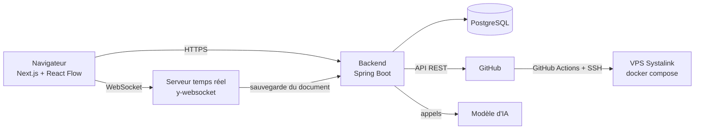

# Architecture

> Document vivant. À mettre à jour à chaque décision importante.

## Vue d'ensemble

## Composants

| Composant | Technologie | Rôle |
|---|---|---|
| Frontend | Next.js, React Flow, Tailwind CSS | Canvas interactif, blocs personnalisés, interface |
| Temps réel | Yjs et serveur y-websocket | Synchronisation des modifications, présence et curseurs |
| Backend | Spring Boot (Java 21) | Comptes, canvas, versions, appels IA, intégration GitHub |
| Base de données | PostgreSQL (JSONB) | Graphes de blocs, historique des versions |
| IA | [fournisseur à préciser] | Esquisse, complétion, audit, sur demande de l'utilisateur |
| Hébergement | Systalink Datacloud | Application et cible de déploiement |

## Décisions à prendre (à trancher avant d'écrire le backend)

| Sujet | Options | Décision | Date |
|---|---|---|---|
| Hibernate (licence LGPL avant la version 7) | Spring Boot 4 (Hibernate 7, Apache 2.0) ou Spring Data JDBC sans JPA | [à décider] | |
| Journaux (Logback : EPL ou LGPL) | Remplacer par Log4j2 (Apache 2.0) | [à décider] | |
| Déploiement Systalink | Workflow GitHub Actions puis SSH et docker compose, ou MCP / API Systalink après lecture de la documentation | [à décider] | |
| Stockage de fichiers | Stockage objet Datacloud, ou rien (SystaDrive introuvable dans l'offre publique) | [à décider] | |
| Jetons GitHub | Ne pas les stocker, ou les chiffrer | [à décider] | |

## Sécurité

- Droits GitHub minimaux demandés à la connexion.
- Authentification des connexions temps réel, et vérification que chaque utilisateur n'accède qu'aux canvas de son projet.
- Quota d'appels IA par utilisateur.
- Journal des actions (génération, envoi sur GitHub, déploiement).
- Aucun secret dans le code ni dans les journaux.

## Décisions prises

<!-- Ajouter une ligne par décision : date, sujet, choix, raison. -->
